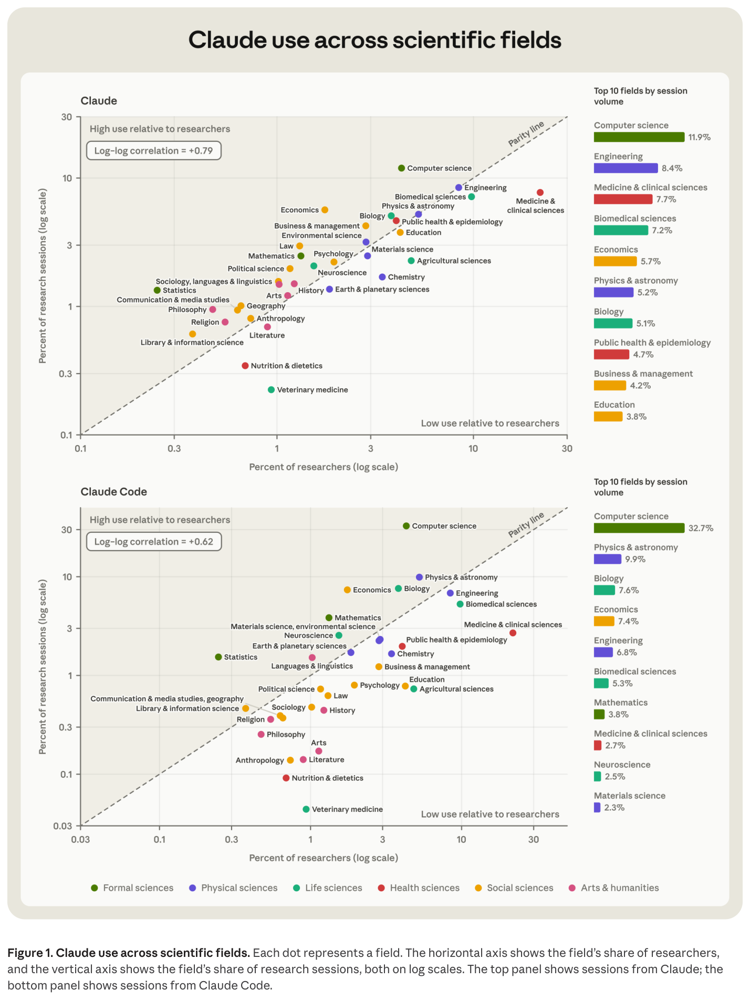
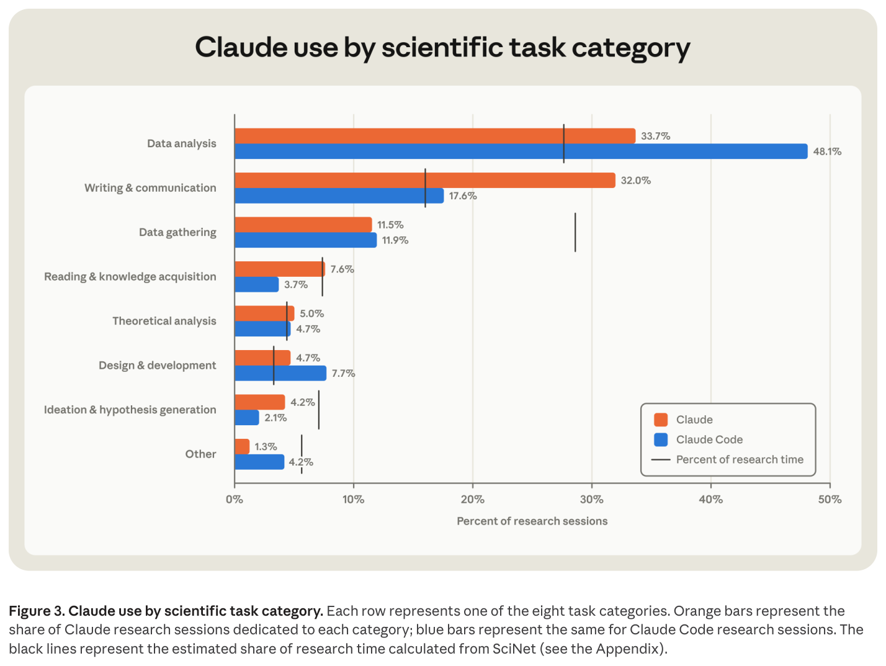
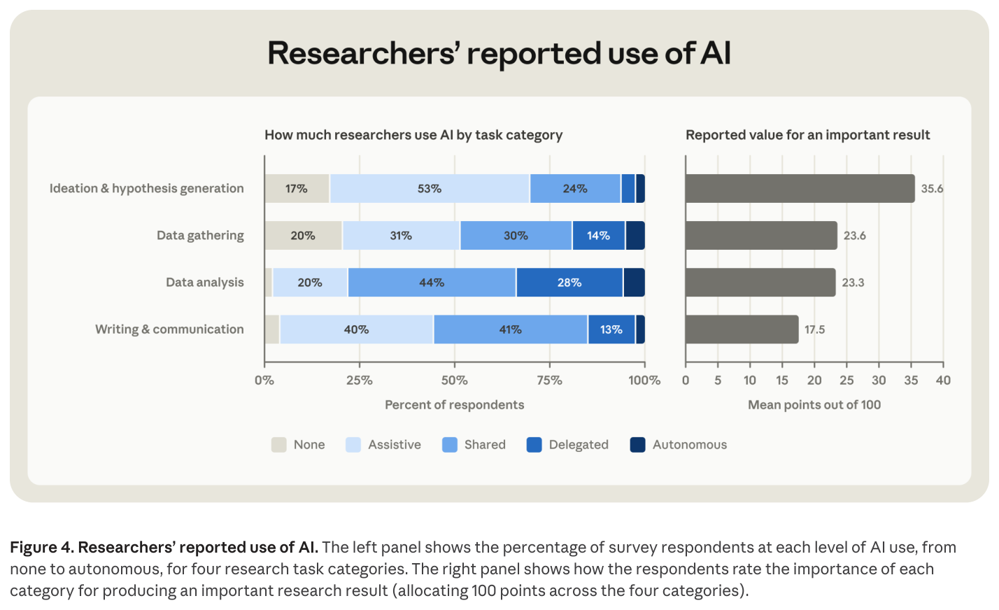
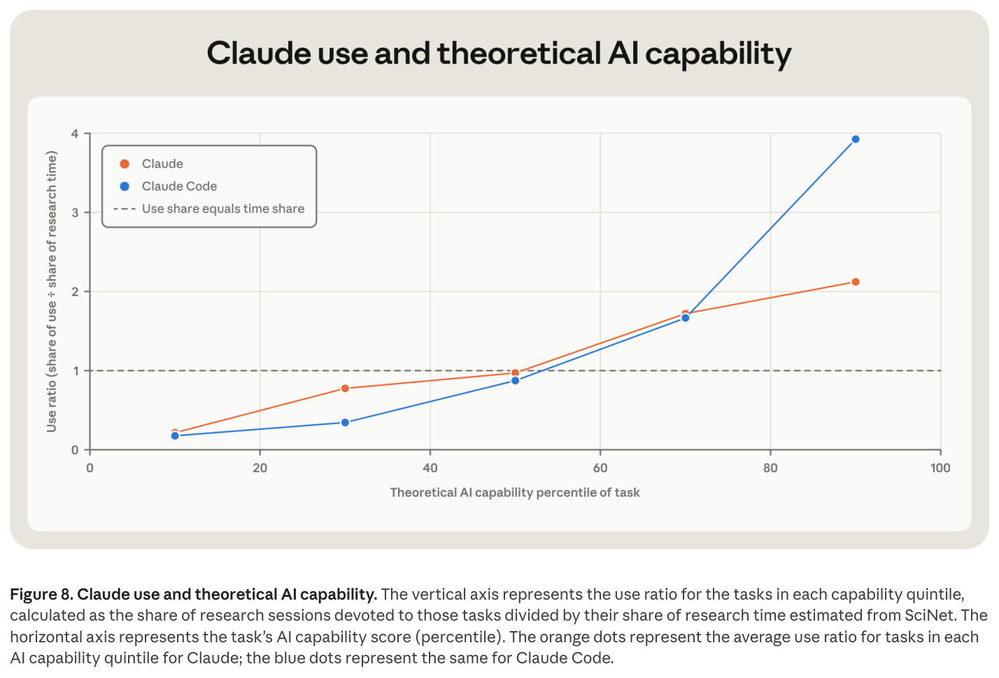
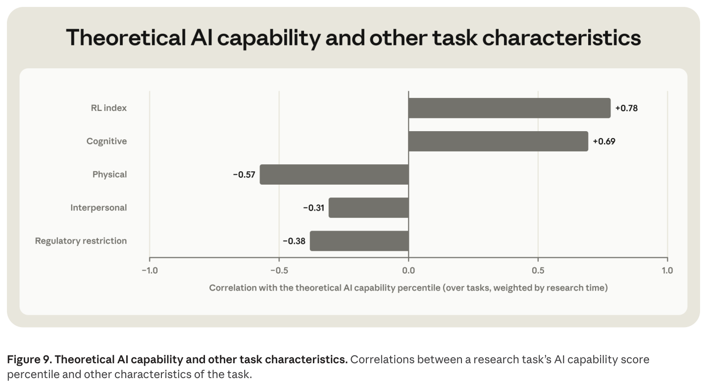
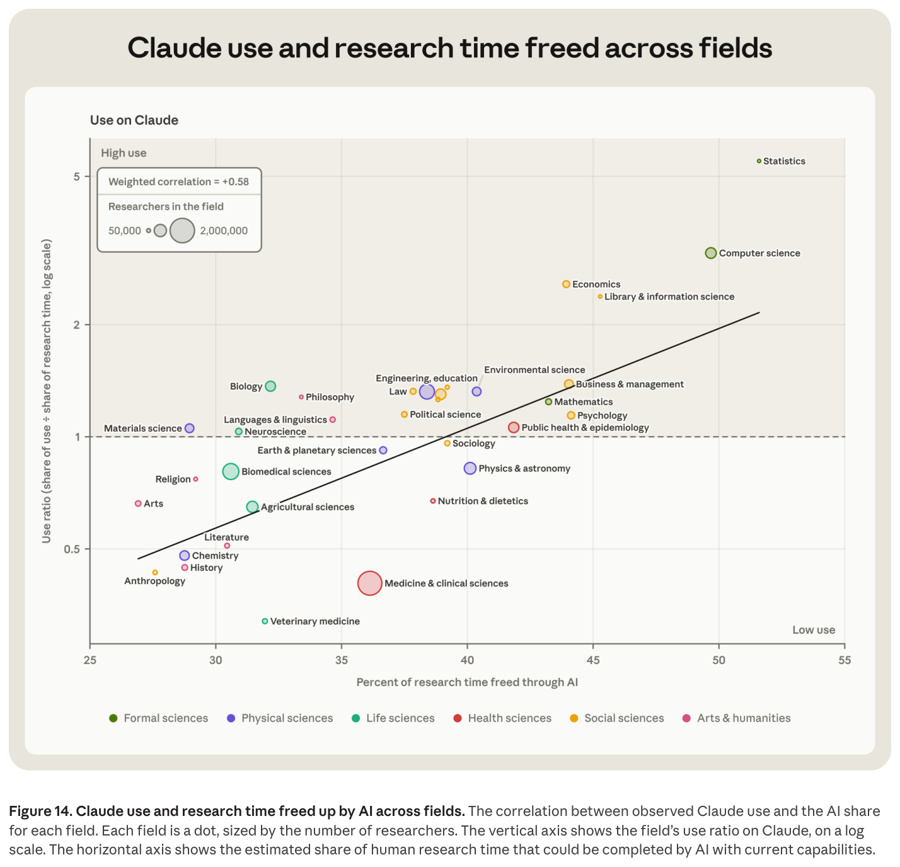
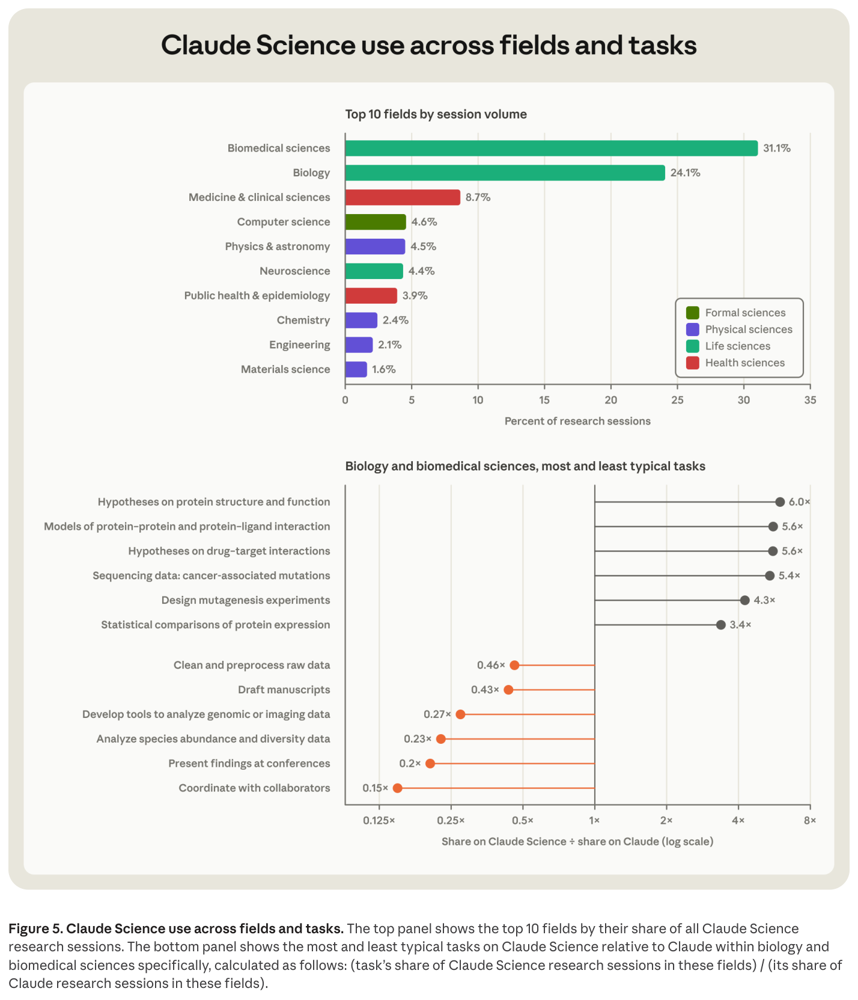
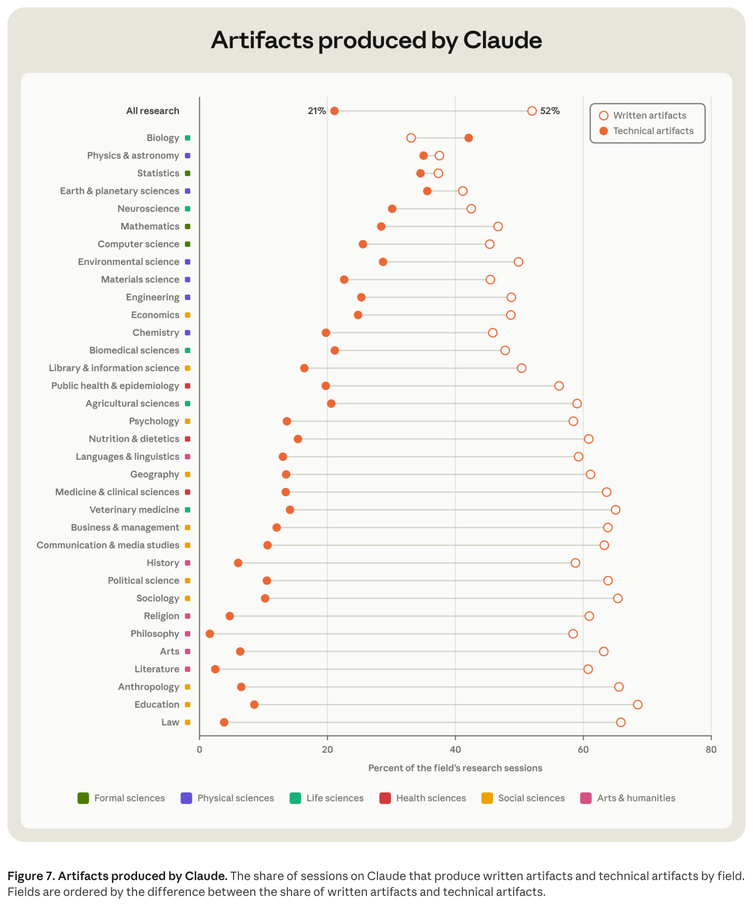
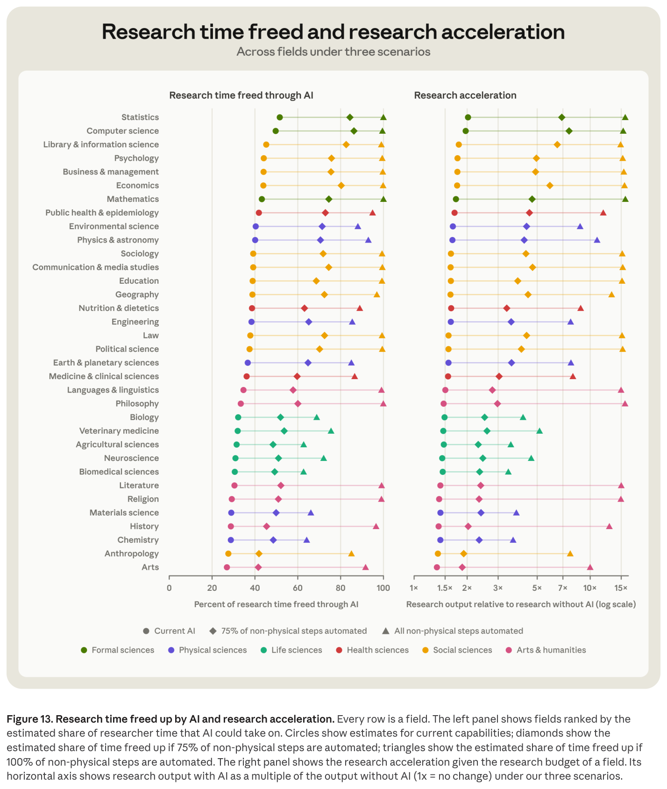
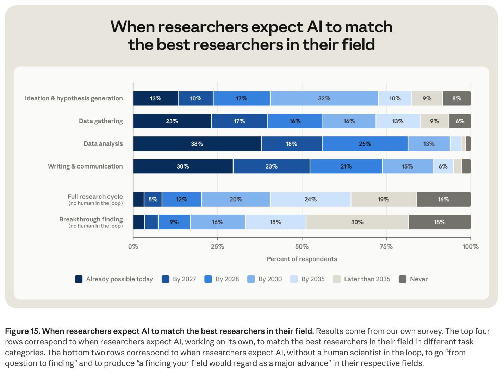

# 1. Introduction

---

"**AI for Scientific Discovery: How Researchers Use Claude**"는 Anthropic이 2026년 11월에 낸 보고서입니다. AlphaFold는 단백질 2억 개의 구조를 예측했고 GNoME는 새 결정 38만 개를 찾았으며 AI는 수십 년 묵은 Erdős 문제를 푸는 데 쓰였습니다. 이 보고서는 이런 시대에 **평범한 연구실의 과학자들이 실제로 AI에게 무슨 일을 시키는지**를 세어 봤습니다.

### 어떻게 셌나

- **데이터:** 2026년 8~9월 두 달간의 연구 세션 **207,049건** (Claude 채팅 128,914건, Claude Code 78,135건)
- **분류:** 과학 연구를 34개 분야, 318개 세부 분야, **7,262개 task**로 쪼갠 SciNet taxonomy에 세션을 하나씩 배정합니다. 분류기는 "화학", "data cleaning" 같은 라벨만 남기고 연구 내용은 저장하지 않습니다.
- **설문:** AI를 적극적으로 쓰는 생명·보건 분야 연구자 528명. Anthropic 연구 지원 프로그램 지원자들이라 보통 과학자보다 AI를 훨씬 많이 쓰는 집단입니다.

### 먼저 보는 10가지 사실

| # | 사실 |
|---|---|
| 1 | 전 세계 연구자의 1.2%인 AI/ML 연구자가 Claude Code 연구 세션의 15.2%를 쓴다 |
| 2 | 과학자가 AI에 가장 많이 시키는 일은 논문 초안 쓰기다. 3위는 리뷰어 코멘트 답변이다 |
| 3 | 과학자들이 가장 중요하다고 꼽은 일에 AI를 가장 적게 쓴다 |
| 4 | 통계 검정에는 들이는 시간의 4배를 쓰고, 크로마토그래피 컬럼 채우기에는 거의 안 쓴다 |
| 5 | AI가 잘하는 연구 작업은 "쉬운 작업"이 아니라 "채점하기 쉬운 작업"이다 |
| 6 | 의학은 AI가 할 수 있는 일이 많은데도 안 쓰고, 철학은 예상보다 많이 쓴다 |
| 7 | 과학 전용 도구에서는 단백질 가설 세우기가 6배 더 자주 나온다 |
| 8 | AI로 글보다 코드를 더 많이 만드는 분야는 34개 중 생물학 하나뿐이다 |
| 9 | 비물리적 작업이 다 자동화되면 철학은 15배 빨라지고 화학은 3배에서 멈춘다 |
| 10 | 연구자의 40%는 2030년까지 AI가 연구 프로젝트를 혼자 해낼 것이라고 본다 |

# 2. 누가, 무엇에 쓰는가

---

## 사실 1. 연구자의 1.2%가 Claude Code 세션의 15.2%를 쓴다

- **AI & machine learning:** 전 세계 연구자의 1.2%인데 Claude 세션의 5.0%, Claude Code 세션의 **15.2%**
- **Computer science 전체:** 연구자의 4.3%가 Claude Code 세션의 **32.7%**
- **Medicine & clinical sciences:** 세션 수로는 3위(7.7%)지만 연구자가 워낙 많아 1인당으로 보면 최하위권
- **Veterinary medicine:** 양쪽 제품 모두에서 맨 아래

점 하나가 분야 하나입니다. **가로축은 그 분야가 전 세계 연구자 중 차지하는 비율, 세로축은 연구 세션 중 차지하는 비율**이고 둘 다 로그 스케일입니다. 위가 Claude, 아래가 Claude Code입니다.

- **대각선 점선**(Parity line)이 기준입니다. 선 위쪽(회색 영역)은 머릿수에 비해 많이 쓰는 분야, 아래쪽은 적게 쓰는 분야입니다.
- 선 위에는 Computer science, Mathematics, Statistics(초록)와 Economics 같은 사회과학(노랑)이 있습니다. Statistics는 연구자 비중이 0.3%도 안 되는데 세션 비중은 1%를 넘습니다.
- 선 아래에는 Chemistry, Agricultural sciences, Veterinary medicine처럼 실험실과 현장에서 일하는 분야가 있습니다. 오른쪽 끝의 빨간 점 Medicine은 환자를 보는 데 시간을 대부분 쓰는 분야라 선에서 한참 떨어져 있습니다.
- 아래 패널(Claude Code)에서는 Computer science가 혼자 위로 튀어 오르고 인문·예술(분홍)은 대부분 선 밑으로 내려갑니다.

세부 분야로 내려가면 눈에 띄는 규칙이 하나 있습니다. 생물학이든 언어학이든 신경과학이든 재료과학이든 이름에 "**computational**"이 붙은 세부 분야는 모두 상위권입니다. Robotics도 물리적 시스템을 다루지만 계산 방법에 크게 기대는 분야라 사용량이 많습니다.

→ **AI를 쓰느냐는 어느 학문이냐보다, 그 학문의 일이 텍스트와 코드로 되어 있느냐에 달려 있습니다.**

## 사실 2. 가장 많이 시키는 일은 논문 초안, 3위는 리뷰어 코멘트 답변

Claude에서 가장 자주 나오는 task 순위입니다.

1. 논문 초안 작성 (18.6%)
2. 문헌 검토와 종합 (6.8%)
3. **피어 리뷰어 코멘트에 답변하기 (6.7%)**

Claude Code에서도 1위는 논문 초안(11.1%)이고 그다음이 결과물 설계·제작(4.8%), 데이터 시각화(4.6%)입니다.

8개 작업 범주별 세션 비중입니다. **주황 막대는 Claude, 파란 막대는 Claude Code, 검은 세로선은 연구자가 실제로 그 작업에 쓰는 시간 비중**입니다. 막대가 검은 선을 넘으면 들이는 시간에 비해 AI를 많이 쓰는 작업입니다.

| 작업 | 연구 시간 | Claude | Claude Code |
|---|---|---|---|
| Data analysis | 27.6% | 33.7% | 48.1% |
| Writing & communication | 16.0% | 32.0% | 17.6% |
| Data gathering | 28.6% | 11.5% | 11.9% |
| Ideation & hypothesis generation | 7.1% | 4.2% | 2.1% |

- 위 두 행은 막대가 검은 선을 넘습니다. 글쓰기는 Claude에서 들이는 시간의 2배입니다.
- 세 번째 행 **Data gathering**은 검은 선이 막대에서 멀리 떨어져 혼자 서 있습니다. 연구 시간을 가장 많이 잡아먹는 작업인데 AI 사용은 절반에도 못 미칩니다.
- 임상 데이터나 생화학 데이터는 몸을 움직여야 모을 수 있어서 그렇습니다. 반대로 온라인 데이터 수집처럼 순수하게 디지털로 하는 수집 작업에는 오히려 시간에 비해 AI를 많이 씁니다.

## 사실 3. 가장 중요한 일에 가장 적게 쓴다

연구자 528명에게 두 가지를 물었습니다. 각 작업에 AI를 얼마나 쓰는지, 그리고 중요한 연구 결과를 내는 데 각 작업이 얼마나 기여하는지(100점을 나눠 배분).

**왼쪽**은 AI 사용 수준의 분포입니다. None → Assistive → Shared → Delegated → Autonomous 순으로 색이 진해집니다. 진할수록 AI에 더 많이 맡긴다는 뜻입니다. **오른쪽**은 중요도 점수의 평균입니다.

| 작업 | 중요도 (100점 중) | AI를 안 쓰거나 보조로만 쓰는 비율 |
|---|---|---|
| Ideation & hypothesis generation | **35.6** | **70%** |
| Data gathering | 23.6 | 51% |
| Data analysis | 23.3 | 약 22% |
| Writing & communication | 17.5 | 약 44% |

- 중요도 1위인 Ideation은 왼쪽 막대가 거의 연한 색입니다. 응답자의 17%는 아예 안 쓰고 53%는 보조로만 씁니다.
- 중요도가 낮은 Data analysis는 Shared 44%, Delegated 28%로 진한 파랑이 넓습니다.

> **과학자들이 가장 중요하다고 꼽은 두 작업(아이디어, 데이터 수집)이 AI를 가장 덜 쓰는 두 작업입니다.** 세션 로그와 설문 결과가 일치합니다.

데이터 수집은 물리적이라 못 쓰지만 아이디어는 물리적이지 않은데도 안 씁니다. 저자들이 든 가능성은 세 가지입니다. 과학자가 아이디어만큼은 직접 내고 싶어 한다, 아이디어는 다른 작업에 섞여 있어 덜 집계된다, AI가 "어떤 질문을 연구할 것인가"라는 판단에 실제로 약하다.

# 3. 왜 거기에만 쓰는가

---

## 사실 4. 통계 검정에는 4배, 컬럼 채우기에는 거의 0

저자들은 재미있는 방법으로 연구 작업 수천 개를 "**AI가 잘할 수 있는 순서**"로 한 줄로 세웠습니다.

- SciNet의 task는 여러 step으로 나뉩니다. 화학의 "반응 혼합물 정제" task 안에 "크로마토그래피 컬럼 충전" step이 있는 식입니다.
- LLM에게 step 두 개를 보여 주고 "**AI가 어느 쪽을 더 잘할 수 있나**"만 묻습니다.
- 이 1:1 대결 결과를 **Bradley-Terry 모델**로 집계합니다. 체스 선수의 Elo rating을 매기는 것과 같은 방식이라 이기면 점수가 오르고 지면 내려갑니다.

말하자면 **연구 작업끼리 체스 리그를 돌린 셈**입니다. 이렇게 나온 점수가 **theoretical AI capability**입니다.

- **가로축:** task의 AI capability 백분위. 오른쪽일수록 AI가 잘하는 작업입니다. 5분위로 묶어 점 5개로 그렸습니다.
- **세로축:** **Use ratio** = (세션 비중) ÷ (연구 시간 비중). 연구 시간의 5%를 차지하는 작업이 세션의 10%를 차지하면 2입니다. 점선(1)이 "들이는 시간만큼만 쓴다"는 기준입니다.
- **주황은 Claude, 파랑은 Claude Code**입니다.

| 구간 | 예시 작업 | Use ratio |
|---|---|---|
| 하위 20% | 반응 혼합물 정제, 참여 관찰 | 약 0.2 (거의 안 씀) |
| 중간 | | 약 1 |
| 상위 20% | 데이터 시각화, 통계 검정 | Claude **약 2**, Claude Code **약 4** |

두 선 모두 왼쪽 아래에서 오른쪽 위로 올라가며 정확히 가운데에서 점선을 지납니다. Claude Code는 점수가 높은 계산 작업에 특화된 도구라 선이 더 가파릅니다.

→ **과학자들은 AI가 통하는 곳을 꽤 정확히 알고 거기에만 씁니다.**

## 사실 5. AI가 잘하는 작업은 "채점하기 쉬운 작업"이다

AI capability 점수가 높은 작업은 어떤 작업일까요. 다른 성질과 얼마나 상관이 있는지 봤습니다.

막대가 오른쪽이면 그 성질이 강할수록 AI가 잘하고 왼쪽이면 못합니다.

- **RL index +0.78** (가장 강함)
- Cognitive +0.69
- Physical −0.57
- Regulatory restriction −0.38
- Interpersonal −0.31

1위인 **RL index**는 그 작업을 강화학습으로 가르치기 얼마나 쉬운지를 나타냅니다. 세 가지를 합친 지표입니다.

1. 성공했는지 **검증하기 쉬운가**
2. 컴퓨터 안에서 예제를 **대량으로 시뮬레이션할 수 있는가**
3. 피드백이 **빨리 돌아오는가**

통계 검정은 셋 다 해당합니다. 코드가 돌았는지, 숫자가 맞는지 몇 초면 채점됩니다. 반면 "이 연구 질문이 좋은 질문이었나"는 몇 년 뒤에야, 그것도 애매하게 판가름 납니다.

> **AI는 지적으로 쉬운 작업이 아니라 채점하기 쉬운 작업을 잘합니다.** 사실 3의 아이디어 공백도 이렇게 읽으면 자연스럽습니다. 좋은 아이디어는 채점이 가장 느리고 애매한 영역입니다.

RL index 하나만 봐도 사용량이 거의 그대로 맞아떨어집니다. RL 적합도 하위 20% 작업은 거의 쓰이지 않고 상위 20%는 Claude 2배, Claude Code 4배입니다.

## 사실 6. 의학은 되는데도 안 쓰고, 철학은 예상보다 많이 쓴다

AI가 할 수 있다고 해서 다 쓰지는 않습니다. 아래 그림에서는 "AI가 할 수 있는 정도"와 "실제로 쓰는 정도"를 분야별로 맞대어 봤습니다.

- **가로축:** 현재 AI가 덜어 줄 수 있는 연구 시간의 비율(AI share). Claude 사용 데이터를 전혀 쓰지 않고 계산한 값입니다.
- **세로축:** Claude에서의 use ratio (로그 스케일). 점선(1) 위면 들이는 시간보다 많이 쓰는 분야입니다.
- **원의 크기**는 연구자 수, **검은 직선**은 전체 추세선입니다 (상관 0.58).

추세선에서 벗어난 점들이 눈여겨볼 만합니다.

- **Statistics (오른쪽 위 끝):** use ratio가 5를 넘습니다. 들이는 시간의 5배 이상을 Claude에서 씁니다. Computer science가 약 3, Economics가 약 2.6으로 뒤를 잇습니다.
- **Medicine & clinical sciences (아래쪽 큰 빨간 원):** AI가 덜어 줄 수 있는 시간은 36%로 중간인데 use ratio는 약 0.4입니다. 추세선에서 가장 멀리 아래로 떨어진 큰 분야입니다.
- **Veterinary medicine:** 맨 아래, 약 0.3입니다.
- **Philosophy, Biology, Materials science:** AI share는 낮은 편인데도 점선 위에 있습니다. 추세보다 많이 씁니다.

저자들은 이렇게 해석합니다.

- **보건 분야가 덜 쓰는 이유:** 의료 데이터와 연구에 걸린 **규제** 때문에 AI를 못 쓰거나 들여오기 어렵습니다.
- **형식 과학, 사회과학, 인문·예술이 더 쓰는 이유:** 일이 텍스트와 코드로 되어 있어 도구를 끼워 넣기 쉽습니다.

→ **"AI가 할 수 있는가"와 "그 일이 AI 손이 닿는 형태로 있는가"가 둘 다 맞아야 AI를 실제로 씁니다.**

# 4. 도구와 결과물

---

## 사실 7. 과학 전용 도구에서는 단백질 가설이 6배 더 나온다

Claude Science는 흩어진 연구용 DB와 도구를 Claude에 연결한 과학 전용 제품입니다. 예를 들어 "기존 약물이 이 단백질에 작용할 수 있을까"를 알아보려면 단백질의 기능, 구조, 이미 시험된 화합물, 관련 임상시험을 각각 다른 DB에서 찾아야 합니다. Claude Science는 이 과정을 한 흐름으로 묶어 줍니다.

- **위 패널:** Claude Science의 분야별 세션 비중입니다. Biomedical sciences(31.1%)와 Biology(24.1%)가 절반을 넘습니다. Computer science가 1위였던 Claude와는 딴판입니다.
- **아래 패널:** 생물·의생명 분야 안에서, 각 task가 Claude에 비해 Claude Science에서 **몇 배 자주 나오는지**입니다 (가로축 로그 스케일, 1×가 같음).

| Claude Science에서 더 자주 | 배수 | 덜 자주 | 배수 |
|---|---|---|---|
| 단백질 구조·기능 가설 | 6.0× | 공동연구자 조율 | 0.15× |
| 단백질 상호작용 모델 | 5.6× | 학회 발표 | 0.2× |
| 약물-표적 상호작용 가설 | 5.6× | 논문 초안 | 0.43× |
| 돌연변이 유발 실험 설계 | 4.3× | 원자료 정제·전처리 | 0.46× |

Claude에서 압도적 1위였던 논문 초안이 여기서는 절반 이하로 줄고 그 자리를 가설과 실험 설계가 채웁니다. 같은 생물·의생명 분야에서 세 제품을 나란히 놓아 보겠습니다.

| 지표 | Claude | Claude Code | Claude Science |
|---|---|---|---|
| 사람 혼자 했다면 걸렸을 시간 | 4.9시간 | 5.9시간 | **10.3시간** |
| 박사급 지식이 필요한 세션 | 48.0% | 67.7% | **82.7%** |
| AI가 높은 자율성으로 수행한 세션 | 23.7% | 64.1% | **73.3%** |

Claude Science에서는 아이디어·가설 작업이 세션의 약 8%입니다. Claude(4.2%)의 2배쯤이고 연구자가 실제로 들이는 시간 비중(7.1%)과 비슷합니다.

→ **AI가 아이디어를 못 낸다기보다 범용 채팅창에 아이디어를 낼 재료가 없었을지도 모릅니다.** 다만 Claude Science를 찾는 사람이 애초에 더 전문적인 일을 하려는 사람일 수 있어서 저자들은 이를 인과가 아닌 사용 패턴의 차이라고 적어 두었습니다.

## 사실 8. 글보다 코드를 더 많이 만드는 분야는 생물학 하나뿐

Claude가 세션에서 만들어 낸 결과물을 **글**(문서, 보고서, 논문, 발표 자료)과 **기술 산출물**(코드, 스크립트, 데이터, 차트)로 나눠 봤습니다.

한 행이 한 분야입니다. **빈 원은 글을 만든 세션의 비율, 채운 원은 기술 산출물을 만든 세션의 비율**이고 두 원 사이가 멀수록 한쪽으로 치우친 분야입니다.

- **전체 평균(맨 위):** 글 52%, 기술 산출물 21%. 과학자들은 Claude로 코드보다 글을 2.5배 더 만듭니다.
- **Biology (둘째 줄):** 채운 원이 빈 원보다 오른쪽에 있는 **유일한 분야**입니다. 기술 산출물 약 42%, 글 약 33%입니다.
- **Physics & astronomy, Statistics:** 두 원이 거의 붙어 있습니다.
- **Philosophy, Literature, Law:** 채운 원이 0 근처에 붙어 있습니다. Philosophy의 기술 산출물은 약 2%입니다.
- **Medicine & clinical sciences:** 자연과학보다 사회과학에 가까운 모양입니다. 글 쪽으로 크게 치우쳐 있습니다.

Claude Code에서는 기술 산출물이 약 2배로 늘지만 분야 간 순서는 비슷합니다.

# 5. 얼마나 빨라질까

---

## 사실 9. 철학은 15배, 화학은 3배에서 멈춘다

저자들은 세 가지 가상 시나리오를 돌렸습니다. 예측이 아니라 구조를 보려는 계산입니다.

| 시나리오 | 가정 |
|---|---|
| 1. Current AI | 지금 수준의 AI가 모든 연구자에게 널리 퍼진다 |
| 2. 75% 자동화 | 비물리적 step의 75%를 AI가 완전히 대신한다 (AI가 잘하는 것부터) |
| 3. 100% 자동화 | 비물리적 step 전부를 AI가 대신한다 |

세 경우 모두 **몸으로 하는 step은 사람이 계속** 합니다. 비용은 AI agent 1시간 $30, 연구자 1시간 $95, 연구자 1시간을 아끼는 데 AI 0.2시간이 든다고 가정했습니다.

이번 그림도 한 행이 한 분야입니다. **왼쪽은 AI가 덜어 주는 연구 시간(%)**, **오른쪽은 같은 예산으로 연구 산출이 몇 배가 되는지**(로그 스케일)입니다. 각 행에서 **동그라미가 시나리오 1, 마름모가 2, 세모가 3**입니다.

| 분야 | 시나리오 1 | 시나리오 2 | 시나리오 3 |
|---|---|---|---|
| Statistics | 2.02배 | 약 7배 | 약 15~16배 |
| Computer science | 1.96배 | 약 8배 | 약 15~16배 |
| Philosophy | 약 1.5배 | 약 3배 | **약 15~16배** |
| Chemistry | 1.41배 | 약 2~3배 | **약 3~4배** |
| Arts | 1.35배 | 2배 이하 | 약 10배 |

- **동그라미(지금 AI):** 모든 분야가 1.35~2배 사이에 모여 있습니다. 거의 모든 일을 머리로 하는 분야도 2배가 한계입니다. 지금은 AI가 대부분 보조나 분담 수준이라 연구자가 여전히 모든 단계에 시간을 쓰기 때문입니다.
- **마름모(75%):** 격차가 벌어집니다. 여기서 덜 오르는 분야가 둘인데 이유가 다릅니다. 실험 과학은 일이 물리적이라서 덜 오릅니다. 인문·예술은 일을 머리로 하지만 AI capability 점수가 낮아 자동화 순번에서 뒤로 밀립니다.
- **세모(100%):** 오른쪽 패널에서 세모가 두 무리로 갈립니다. Philosophy, Literature, Religion 같은 인문학이 통계학, 컴퓨터과학과 나란히 **오른쪽 끝**(15~16배)에 붙습니다. Biology, Chemistry, Materials science, Biomedical sciences(초록과 보라)는 **3~4배**에서 멈춥니다.

실험 과학은 연구 시간의 약 40%가 물리적 step이라 여기서 멈춥니다 (분야 중앙값은 4%). 자동화된 실험실이 없으면 이 40%가 그대로 남습니다. 연구 작업들은 서로 대신할 수 없어서 **가장 짧은 널빤지가 물통의 수위를 정하듯** 남은 병목이 전체 속도를 정합니다.

**💡 그런데 왜 하필 16배에서 멈출까**

AI에 완전히 맡긴 작업의 비용은 $30 × 0.2시간 = **$6**입니다. 연구자가 직접 하면 **$95**입니다. 약 1/16입니다.

> **병목이 사라진 분야의 다음 한계는 AI의 가격입니다.** AI 비용이 절반이 되면 천장은 2배로 올라갑니다. 물리적 병목이 있는 분야는 AI가 아무리 싸져도 3~4배에서 움직이지 않습니다.

가장 크게 가속되는 분야 목록에는 **AI를 만드는 분야**도 들어 있습니다. AI 연구가 빨라지면 더 좋은 AI가 나오고 그 AI가 다시 연구를 빠르게 하는 되먹임 고리가 생길 수 있습니다.

이 계산이 빠뜨린 것도 있습니다. Large Hadron Collider처럼 분야 전체가 나눠 쓰는 설비의 한계와 실험 장비·재료비는 넣지 않았으니 실제로는 더 느릴 수 있습니다. 반대로 시뮬레이션이 실험을 대신하거나 AI가 더 좋은 가설을 고를 가능성도 빠져 있어서 실제로는 더 빠를 수도 있습니다.

## 사실 10. 연구자의 40%는 2030년까지 AI가 혼자 연구할 것이라고 본다

"AI가 혼자서 당신 분야 **최고 연구자** 수준에 도달하는 때는 언제인가"를 물었습니다.

색이 진할수록 이른 시점입니다. 가장 진한 남색이 **"이미 가능"**, 연한 파랑이 2035년까지, 베이지가 2035년 이후, 회색이 "영원히 불가"입니다. **위 4행은 개별 작업, 아래 2행은 사람 없이 처음부터 끝까지 하는 연구**입니다.

| 질문 | 이미 가능 | 2030년까지 (누적) | 영원히 불가 |
|---|---|---|---|
| Data analysis | **38%** | 94% | 1% 안팎 |
| Writing & communication | 30% | 89% | 3% 안팎 |
| Ideation | 13% | 72% | 8% |
| Data gathering | 23% | 72% | 6% |
| 연구 전 과정을 혼자 | 3% 안팎 | **약 40%** | 16% |
| 분야의 중대한 발견을 혼자 | 3% 안팎 | 약 3분의 1 | 18% |

- 데이터 분석은 응답자 열에 넷이 "**이미 최고 연구자 수준**"이라고 답했습니다.
- 지금 덜 쓰는 작업(아이디어, 데이터 수집)은 기대도 낮습니다. 막대의 진한 부분이 눈에 띄게 좁습니다.
- 맨 아래 행은 가장 보수적입니다. 절반 가까이(30% + 18%)가 중대한 발견은 2035년 이후이거나 영원히 안 된다고 봅니다.

이 예상이 과하다고 단정하기는 어렵습니다. 과거의 AI 예측은 대체로 실제보다 늦게 잡혔습니다.

- **2022년 중반의 예측:** AI가 국제수학올림피아드(IMO) 금메달 수준에 도달하는 시점은 분야 전문가 중앙값 2030년, superforecaster 중앙값 2035년
- **실제:** **2025년**

5~10년을 빗나간 셈입니다. 다만 이렇게 빗나가지 않은 예외가 있었는데 생물학 실험 보조처럼 **물리 세계에서 손을 써야 하는 영역**이었습니다. 이 보고서 전체에서 반복되는 패턴과 같습니다.

# 6. 남는 질문

---

능력이 좋아진다고 과학이 저절로 빨라지지는 않습니다. 저자들이 꼽은 걸림돌 가운데 눈에 띄는 몇 가지를 추렸습니다.

- **병목은 없어지지 않고 옮겨 간다.** 질문에 답하는 값이 싸질수록 "무엇을 물을까"가 병목이 됩니다. AI가 좋은 질문을 낼 수 있는지는 아직 모릅니다. 과학이 얼마나 빨라질지는 여기에 가장 크게 달려 있습니다.
- **논문이 쏟아지면 누가 읽나.** 과학계가 결과를 다 읽고 검증하지 못하는 상황이 먼저 올 수 있습니다. 검증과 심사도 결국 AI가 맡을지도 모릅니다.
- **일부러 느리게 가야 할 때.** 생물학에서는 의학을 앞당기는 바로 그 능력이 위험한 지식도 만들 수 있습니다. 저자들은 연구 과정에 의도적인 checkpoint를 두고 속도를 일부 포기해야 할 수도 있다고 씁니다.
- **연구자의 44%.** 미국 연방 과제 책임자들은 연구 시간의 약 44%를 행정 요건을 맞추는 데 씁니다. AI가 이쪽을 가져가면 연구는 더 즐거워지고 즐거운 쪽을 가져가면 반대가 됩니다.

→ **AI는 지금 과학에서 채점하기 쉬운 절반을 빠르게 가져갑니다. 앞으로의 속도는 남은 절반, 곧 손으로 하는 실험과 무엇을 물을지 정하는 일이 정합니다.**
