# 1. Introduction

---

> 원문: [The components of agent memory](https://www.anthropic.com/research/components-of-agent-memory) (Anthropic Engineering, 2026-11-06)

### 1. 배경 및 문제 제기

키르케고르는 "삶은 뒤돌아봐야만 이해할 수 있지만, 앞을 보며 살아야 한다"고 썼습니다. 에이전트 메모리 설계가 정확히 이 딜레마에 놓여 있습니다.

- 에이전트는 **작업하는 도중에** 무엇을 기억할지 정해야 합니다. 그런데 그 시점에는 **앞으로 무엇이 필요할지 알 수 없습니다.**
- 그 자리에서 쓴 노트는 처음부터 틀렸을 수도 있고 환경이 바뀌면서 낡아버릴 수도 있습니다. 문제는 다음 세션의 에이전트가 그 노트를 **의심 없이 믿는다**는 데 있습니다.

사람의 뇌는 이 문제를 분업으로 풉니다. 해마(hippocampus)가 깨어 있는 동안 경험을 빠르게 붙잡아 두고, 잠자거나 쉬는 동안 그 경험을 재생(replay)하며 신피질의 장기 지식으로 정리합니다.

여기서 말하는 **agent memory**의 범위도 짚고 갑니다. Claude가 경험에서 얻어 **세션 사이에 유지하는 지식**, 즉 나중에 읽을 수 있는 context로 저장된 것만 가리킵니다. weight 업데이트, in-context learning, compaction(오래된 턴을 요약으로 대체)은 포함하지 않습니다.

### 2. 제안: 메모리 계층 + Dreaming

Anthropic은 같은 분업을 에이전트에 적용합니다. 세션 중에는 중요한 것만 재빨리 적어 두고 세션과 세션 사이의 한가한 시간에 로그를 되돌아보며 메모리를 정리합니다. 이 오프라인 정리 과정을 **dreaming**이라 부릅니다 (Letta·UC Berkeley의 sleep-time compute와 같은 계열의 아이디어).

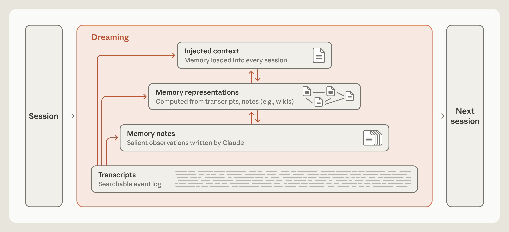

이 그림이 글 전체의 지도입니다. 왼쪽의 Session이 끝나면 가운데 주황색 Dreaming 박스를 거쳐 오른쪽 Next session으로 넘어갑니다. 박스 안에는 아래에서 위로 네 개 층이 쌓여 있습니다.

| 층 (아래 → 위) | 내용 | 접근 방식 |
|---|---|---|
| **Transcripts** | 세션의 전체 이벤트 로그 | 필요할 때 검색 |
| **Memory notes** | Claude가 중요하다고 판단해 직접 쓴 관찰 | 필요할 때 읽기 |
| **Memory representations** | transcript·note로부터 계산한 구조물 (예: wiki) | 링크를 따라 탐색 |
| **Injected context** | 모든 세션 시작 시 자동으로 실리는 메모리 | 항상 로드됨 |

- 위로 갈수록 **양은 적어지고 접근 비용은 싸집니다.** 맨 아래는 다 있지만 찾아야 하고, 맨 위는 찾을 필요가 없지만 아주 조금만 올릴 수 있습니다.
- 주황색 화살표가 dreaming이 하는 일입니다. Transcripts에서 세 개 층 각각으로 올라가는 화살표, 그리고 인접한 위층끼리 오가는 양방향 화살표가 있습니다. Dreaming은 **원본 로그를 근거로 각 층을 새로 쓰고, 층 사이에서 내용을 올리거나 내립니다.**

→ **세션 중에는 "앞을 보며" 노트를 쓰고, dreaming이 "뒤돌아보며" 그 노트를 고치고 구조화합니다.**

### 3. 핵심 결과

- **노트 쓰기 능력은 모델 세대에 따라 급격히 좋아졌습니다.** CL-Bench에서 Opus 5는 메모리 하나로 0.564 → 0.828.
- **적게 쓰는 모델이 더 멀리 갑니다.** Pokémon에서 Sonnet 3.7은 413개 파일로 배지 1개, Fable 5는 10개 파일로 배지 4개.
- **강한 모델일수록 규칙을 정해주면 손해입니다.** "실패만 기록하라"는 규칙 하나로 Opus 5의 메모리 이득이 0.234 줄었습니다.
- **Dreaming은 틀린 노트 한 줄을 고쳐 결과를 바꿉니다.** 고친 run만 다음 도시에 도달했습니다.
- **Wiki는 만능이 아닙니다.** 여러 문서를 종합해야 하는 질문에서는 87% vs 73%로 이기지만 한 문서만 찾으면 되는 과제에서는 이득이 없었습니다.

# 2. Memory notes: 노트는 미래에 대한 예측이다

---

## 2.1 학습 루프를 닫는 모델, 못 닫는 모델

노트를 쓴다는 건 일종의 **예측**입니다. 규칙을 적는다는 건 "이 패턴이 또 나올 것"이라는 예측이고, 검증된 사실을 적는다는 건 "미래의 내가 이걸 재확인 없이 믿고 싶어 할 것"이라는 예측입니다.

이를 **CL-Bench 1.0**(Continual Learning Bench)의 database task로 측정했습니다.

- Claude가 데이터베이스를 조회해 연속된 질문에 답합니다. 답을 내면 정답을 알려주고, Claude는 다음 질문에 대비해 메모리를 쓸 수 있습니다.
- Claude Managed Agents로 실행했고 **질문마다 새 세션**으로 시작합니다. 세션 간에 이어지는 것은 메모리 디렉토리 하나뿐입니다.
- 이상적인 학습 루프: **실패 기록 → 원인 가설 수립 → 가설 검증 → 규칙으로 정리.**

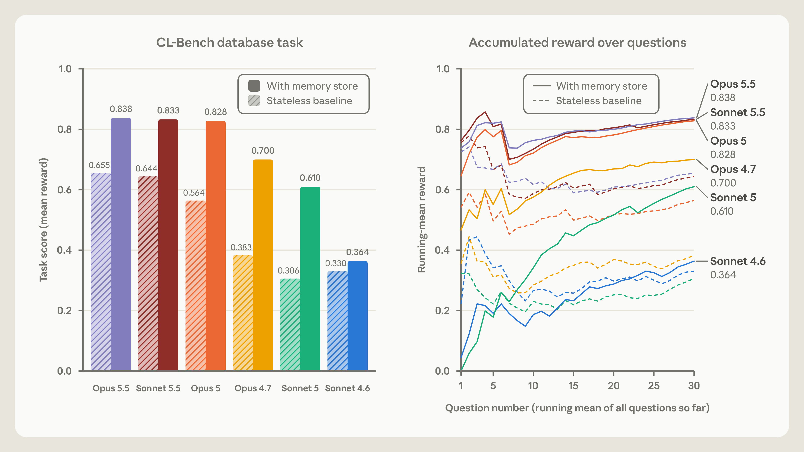

**왼쪽 막대 그래프**는 모델별 평균 reward입니다. 빗금 막대가 메모리 없는 stateless baseline, 진한 막대가 memory store를 붙인 경우입니다.

| 모델 | Baseline | With memory | 이득 |
|---|---|---|---|
| Opus 5.5 | 0.655 | 0.838 | +0.183 |
| Sonnet 5.5 | 0.644 | 0.833 | +0.189 |
| Opus 5 | 0.564 | 0.828 | +0.264 |
| Opus 4.7 | 0.383 | 0.700 | +0.317 |
| Sonnet 5 | 0.306 | 0.610 | +0.304 |
| Sonnet 4.6 | 0.330 | 0.364 | +0.034 |

- Sonnet 4.6만 두 막대가 거의 붙어 있습니다. **메모리를 줘도 쓸 줄 모르면 소용이 없습니다.**
- Opus 5 이상 세 모델은 메모리를 쓰면 0.83 근처로 모입니다. 5.5 세대는 baseline 자체가 더 높아서 이득 폭은 오히려 작게 보입니다.

**오른쪽 선 그래프**는 30개 질문을 풀어 가는 동안의 누적 평균 reward입니다(실선 = 메모리 있음, 점선 = 없음). 실선은 질문이 쌓일수록 꾸준히 올라가고 점선은 평평하거나 느리게 움직입니다. 특히 초록색 Sonnet 5는 0에서 출발해 0.61까지 가장 가파르게 오릅니다. **질문을 풀수록 잘하게 됩니다. 이것이 메모리가 만든 학습 곡선입니다.**

점수 차이는 메모리 디렉토리 내용에서 그대로 드러납니다.

- **Sonnet 4.6** — 왜 틀렸는지 가설을 세우는 데서 멈춤. 검증 안 된 추측을 담은 파일이 흩어져 있음.
- **Opus 4.7** — 노트를 하나의 reference 문서로 통합하고 확인한 사실과 미확인 사실을 구분하기 시작.
- **Sonnet 5** — 채점 후 각 답을 confirmed로 표시하고 틀리면 correction을 기록.
- **Opus 5** — **처음으로 루프를 닫은 모델.** 대부분의 항목에 규칙 + 그 규칙이 참인 근거 + 이전 질문의 답 + 발견한 함정을 알리는 경고가 들어 있음.

→ **메모리의 품질은 "얼마나 적었나"가 아니라 "검증까지 마친 규칙을 적었나"로 갈립니다.**

## 2.2 무엇이 기억할 가치가 있는가 (salience)

두 번째 실험은 **Pokémon Red**입니다. 각 모델에 읽고 쓸 수 있는 메모리 폴더를 주고 약 10,000 step 시점의 폴더를 비교했습니다.

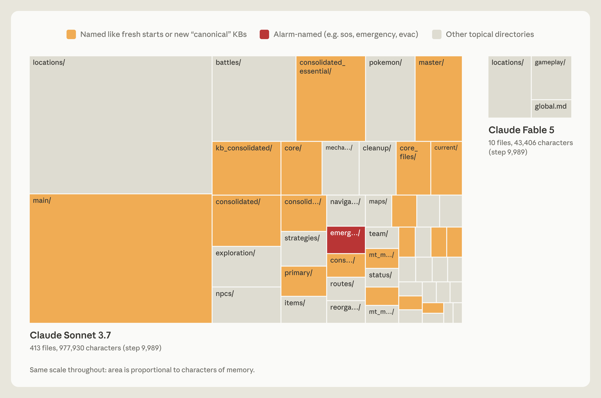

두 treemap은 **같은 축척**이고 면적은 메모리 글자 수에 비례합니다. 그래서 크기 차이가 곧 메모리 양의 차이입니다.

- **왼쪽 Sonnet 3.7** — 413개 파일, 977,930자. 225개 폴더에 흩어져 있습니다.
  - 주황색 = "새 출발"이나 "정본(canonical)"처럼 이름 붙은 폴더입니다. `main/`, `master/`, `consolidated/`, `kb_consolidated/`, `consolidated_essential/`, `core/`, `primary/`... **정리하려고 만든 폴더가 계속 새로 생겼다**는 흔적입니다.
  - 빨간색 = `emergency` 같은 경보성 이름의 폴더.
- **오른쪽 Fable 5** — 10개 파일, 43,406자. `locations/`, `gameplay/`, `global.md`가 전부입니다. 약 **1/22 크기**입니다.

결과는 Sonnet 3.7 배지 1개, Fable 5 배지 4개였습니다. 왜 이런 차이가 났을까요?

**Sonnet 3.7: 전부 중요할 수 있다고 가정하고 가리지 않고 기록**
- 전투마다, 아이템마다, NPC마다 파일을 따로 만들었습니다.
- 그런데 Pokémon의 게임 상태는 계속 바뀝니다. 꼼꼼한 기록일수록 **빨리 낡습니다.**
- 그 결과 게임을 하는 대신 메모리를 뒤지고 정리하는 데 시간을 썼습니다. step 10,000 무렵에는 네 번째 "master" 폴더를 만들기 시작했고 이후 17 step 동안 파일 6개 생성, 9개 삭제, **게임 내 행동은 0회**였습니다.

**Fable 5: 게임이 알려주지 않는 것만 기록**
- 소지금이나 현재 위치는 매 턴 화면에서 읽을 수 있으니 저장하면 중복입니다.
- 반대로 전략, 계획, 검증된 규칙은 **직접 알아내야만 존재하고 적어두지 않으면 사라집니다.**
- `global.md`는 대시보드 역할: 현재 목표, 체육관 공략 계획, 그리고 **메모리를 어떻게 쓸지 스스로 정한 규칙**.
- `gameplay/`의 실제 노트 예: Magikarp에게 Poké Ball 7개를 연속 실패한 뒤 *"3개 이상 연속 실패하면 타이밍을 바꿔라 (메뉴 단계 사이에 'wait'을 추가) — 이렇게 한 직후에 잡혔다."*

→ **좋은 메모리는 일기장이 아니라 치트시트입니다. 화면에서 다시 읽을 수 있는 건 적지 않고, 고생해서 알아낸 것만 적습니다.** Opus 5.5도 같은 방식으로 작은 폴더를 유지하며 게임을 끝까지 깼습니다.

## 2.3 Steering: "무엇을 위한 것인지"만 알려줘라

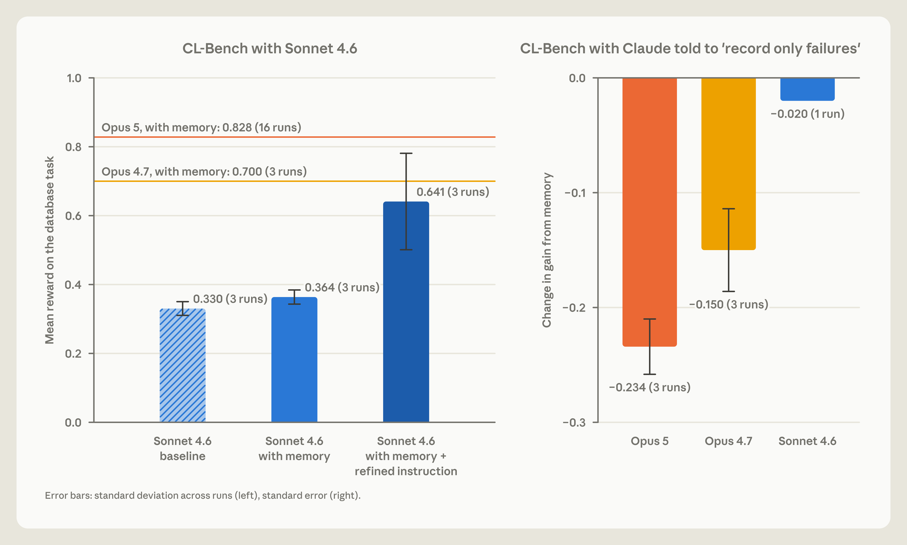

**왼쪽 (약한 모델에는 프롬프트가 큰 도움)** — Sonnet 4.6 하나를 세 조건에서 비교합니다.

- baseline 0.330 → 메모리만 제공 0.364 → **메모리 + 정제된 지시 0.641**
- 추가한 지시는 두 가지입니다: 답하기 전에 메모리 파일을 읽을 것, 가설을 명시적으로 검증할 것.
- 가로 기준선은 Opus 4.7(0.700)과 Opus 5(0.828)의 메모리 사용 점수입니다. 프롬프트만으로 Sonnet 4.6이 Opus 4.7 근처까지 올라온 셈입니다. 다만 오차 막대가 크니(3 runs) 감안해서 봐야 합니다.
- 참고로 Sonnet 5는 시키지 않아도 10번 중 9번 메모리를 먼저 읽습니다. Sonnet 4.6은 절반 미만이었습니다.

**오른쪽 (강한 모델에는 규칙이 독)** — "실패만 기록하라"는 규칙을 줬을 때 메모리 이득이 얼마나 변했는지입니다. 막대가 아래로 길수록 손해가 큽니다.

- Opus 5: **−0.234**, Opus 4.7: **−0.150**, Sonnet 4.6: −0.020 (1 run)
- 강한 모델일수록 손실이 큽니다. 2.1에서 봤듯 Opus 5의 강점은 검증된 규칙과 정답까지 함께 적는 것인데 "실패만"이라는 규칙이 그걸 막아버렸기 때문입니다.

> 💡 **메모리가 무엇을 위한 것인지는 말해주되, 어떻게 쓸지는 정해주지 마라.** 프런티어 모델에는 "사용자가 요청했거나 분명히 기억할 가치가 있을 때 노트를 남겨라" 정도의 단순한 안내만 주고 판단은 모델에 맡깁니다.

# 3. Dreaming ①: 틀린 메모리를 고친다

---

노트는 세션 중의 판단으로 쓰이기 때문에 틀릴 수 있습니다. Dreaming 단계에서는 노트를 **원본 transcript와 대조**해 볼 수 있습니다. Transcript가 곧 ground truth입니다.

**상황: Mt. Moon의 함정**

- Mt. Moon은 입구가 서쪽, 출구가 동쪽인 동굴입니다. 입구 근처에는 **한 번 내려가면 못 올라오는 ledge**가 있어 뛰어내리면 지나온 길로 되돌아갑니다.
- Claude는 입구의 PokéCenter를 랜드마크로 쓰고 있었는데 노트에 **"PokéCenter는 동쪽에 있다"고 잘못 적었습니다.**
- 그래서 PokéCenter에서 나오며 *"Mt Moon is behind me"*라고 선언하고 노트를 "Mt Moon DONE"으로 갱신했습니다. 실제로는 아직 산을 넘지 않았습니다.
- 몇 번의 행동 뒤 ledge에서 떨어졌습니다. 내비게이션 도구에 낙차가 표시되지 않아 Claude는 *"서쪽으로 너무 많이 갔다"*고 결론 내렸고 자신이 맞는 쪽에 있었다는 믿음은 그대로 유지했습니다.

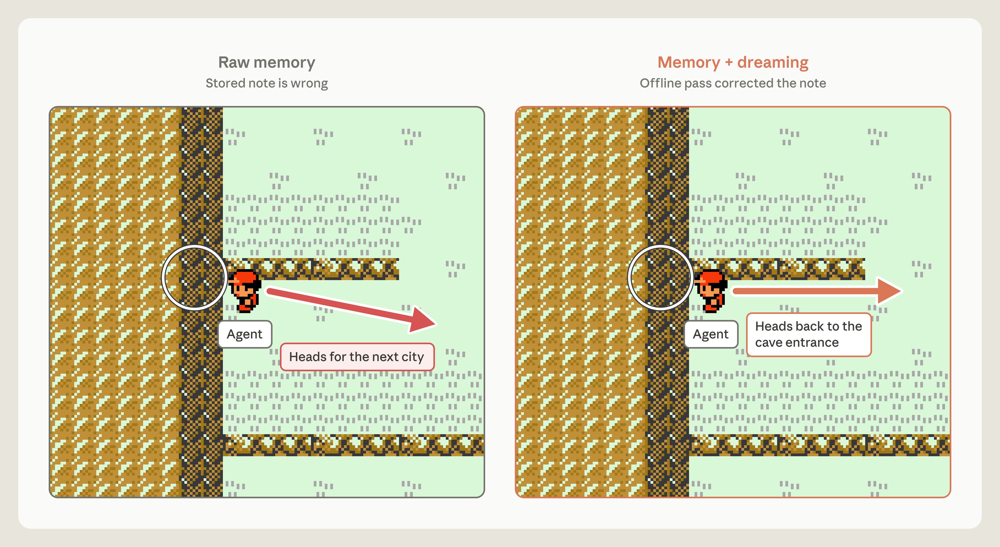

두 패널은 **같은 위치, 같은 순간**입니다. 달라진 것은 메모리 노트 한 줄뿐입니다.

- **왼쪽 Raw memory** — 노트가 틀린 상태. Claude는 산을 이미 지났다고 믿고 다음 도시를 향해 오른쪽 아래로 내려갑니다. 그 방향에 ledge가 있습니다.
- **오른쪽 Memory + dreaming** — 오프라인 pass가 노트를 고친 상태. Claude는 *"이제 Mt Moon 동굴 입구를 찾아 다시 들어가야 한다"*며 동굴 입구로 향합니다.

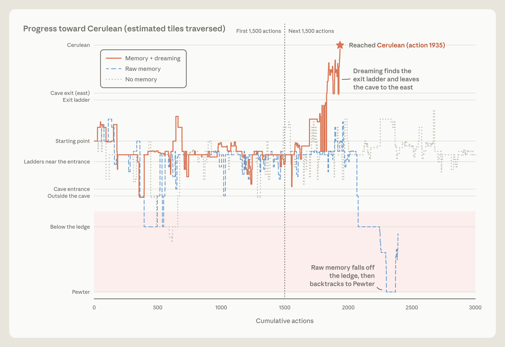

가로축은 누적 행동 수(0~3,000), 세로축은 Cerulean City까지의 진행도입니다. 아래부터 Pewter(이전 마을) → ledge 아래 → 동굴 입구 → 시작 지점 → 출구 사다리 → 동굴 출구 → Cerulean 순이며, 분홍색 영역은 ledge 아래의 **후퇴 구간**입니다.

- **주황 실선 (Memory + dreaming)** — 초반 1,500 action 동안은 시작 지점 근처를 맴돌지만 이후 출구 사다리를 찾아 급상승하고 **action 1,935에서 Cerulean에 도달**합니다.
- **파란 점선 (Raw memory)** — 2,000 action 무렵 ledge에서 떨어져 분홍 영역으로 추락하고 결국 Pewter까지 되돌아갑니다.
- **회색 점선 (No memory)** — 3,000 action 내내 동굴 중간을 오르내릴 뿐 끝까지 도달하지 못합니다.

Raw memory run에는 뒷이야기가 더 있습니다. Claude는 같은 ledge에서 **세 번** 떨어졌고 세 번째 뒤에는 *"계속 루프를 도느니 멈추겠다"*고 썼습니다. 자동 응답이 계속하라고 지시하자 회복과 보급을 위해 Pewter City까지 돌아갔고 run은 거기서 끝났습니다.

> 💡 **틀린 메모리는 메모리가 없는 것만큼 나쁩니다.** 두 run 모두 산을 넘지 못했습니다. 차이를 만든 것은 메모리의 유무가 아니라 정확성이었고, 그 정확성은 transcript라는 원본과 대조해서 확보했습니다.

# 4. Dreaming ②: 새로운 메모리 표현(wiki)을 만든다

---

## 4.1 Wiki는 dreaming을 거듭할수록 자란다

노트가 쌓이면 찾기가 어려워집니다. Dreaming은 노트와 transcript로부터 **wiki**를 만들 수 있습니다. Wiki는 Claude가 직접 쓰고 관리하는 페이지 모음으로, 한 주제에 대해 아는 것을 모으고 다른 페이지에 링크합니다. 이 링크가 메모리를 뒤질 때 **지도**가 됩니다.

**실험 설정**
- Corpus: Stainless(5월에 Anthropic이 인수한 소프트웨어 회사)의 내부 문서 약 35만 개 파일, 약 4.2억 token
- 평가: 이 corpus를 다루는 질문 25개
- Wiki 생성: Opus 5 에이전트가 128개 세션에 걸쳐 파일 탐색 → 링크된 wiki 페이지 작성·수정 → 중복 병합 → 출처 대조. 세션들은 shared log로 작업을 조율하며 이전 세션의 결과 위에 쌓아 갑니다.

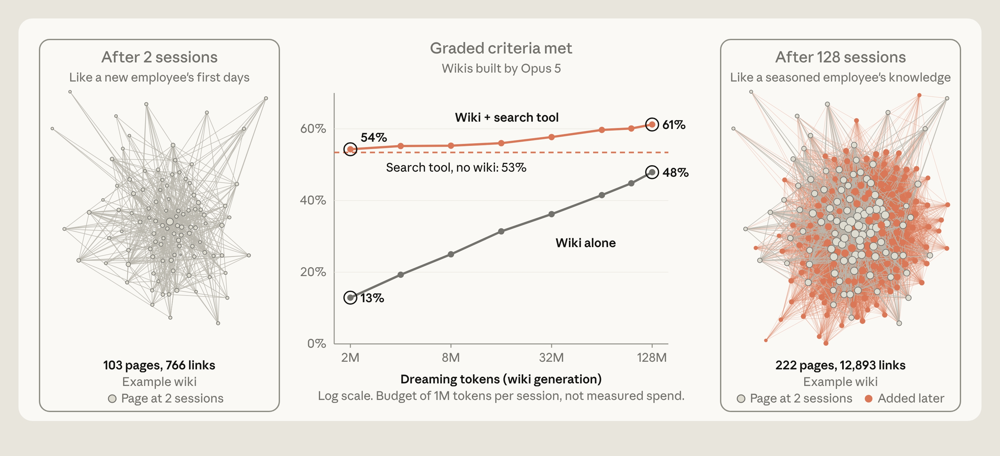

**가운데 그래프** — 가로축은 wiki 생성에 쓴 dreaming token 예산(2M → 128M, log scale, 세션당 1M), 세로축은 채점 기준 충족률입니다.

- **회색 선 (Wiki alone)** — 13% → **48%**. Wiki만 보고 답할 때. 가장 가파르게 오르지만 끝까지 가도 search보다 낮습니다.
- **주황 점선 (Search tool, no wiki)** — **53%** 고정. Wiki 없이 원본을 검색만 할 때.
- **주황 실선 (Wiki + search tool)** — 54% → **61%**. 둘을 함께 쓸 때가 가장 높고 wiki가 커질수록 격차가 벌어집니다.

**양옆 네트워크 그래프** — 점 하나가 wiki 페이지, 선이 링크입니다.
- 왼쪽 (2 세션 후): 103 페이지, 766 링크 — "신입사원의 첫 며칠"
- 오른쪽 (128 세션 후): 222 페이지, 12,893 링크 — "베테랑 직원의 지식". 주황색이 나중에 추가된 페이지입니다.
- 페이지는 2배 남짓 늘었는데 **링크는 약 17배** 늘었습니다. 지식의 양보다 **지식 사이의 연결**이 훨씬 빠르게 자랐습니다.

→ **Wiki는 search를 대체하지 못하지만 search 성능은 끌어올립니다.** 어디를 찾아야 할지 알려주는 지도이기 때문입니다. Wiki + search 조합은 질문당 약 20,000 token도 절약했습니다.

## 4.2 Wiki가 도움이 되는 과제, 안 되는 과제

어떤 과제에서 wiki가 유효한지 보려고 합병(merger) 관련 문서 묶음과 **Harvey LAB benchmark**(문서를 주고 legal brief를 쓰게 한 뒤 기준 목록으로 채점)를 사용했습니다.

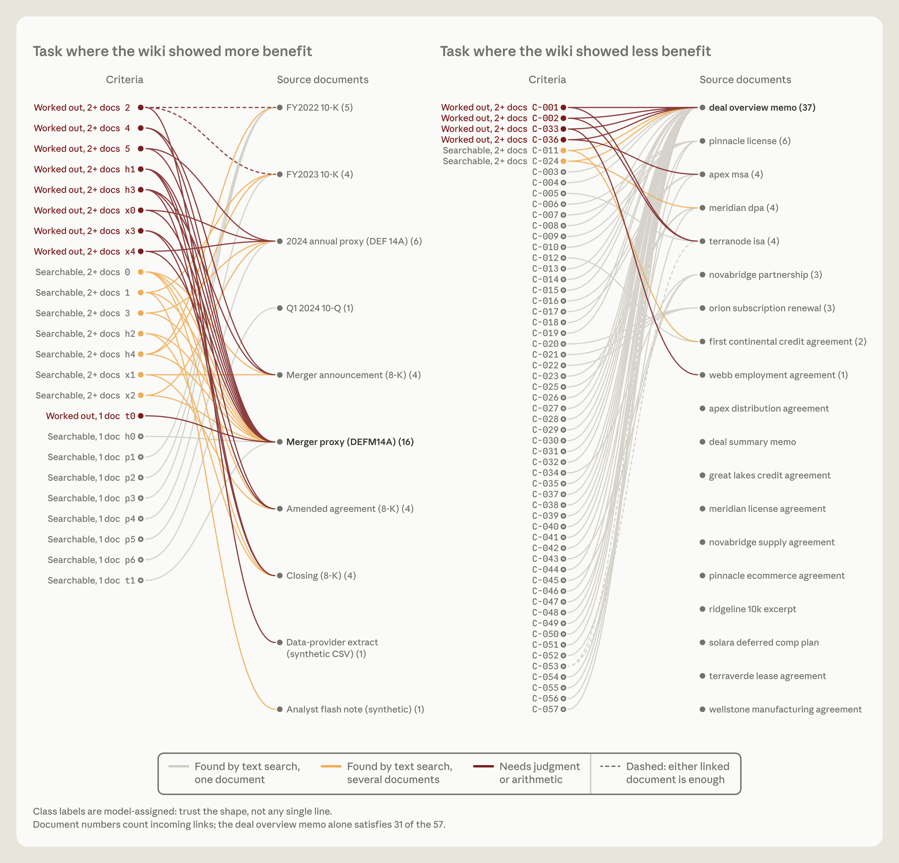

각 패널의 왼쪽 열은 채점 기준(criteria), 오른쪽 열은 원본 문서입니다. 선은 "이 기준을 충족하려면 이 문서가 필요하다"를 뜻합니다.

- **회색 선** — 문서 하나에서 text search로 찾을 수 있음
- **주황 선** — text search로 찾되 여러 문서가 필요함
- **진한 빨강 선** — 판단이나 산술 계산이 필요함

**왼쪽: wiki가 도움이 된 과제** (합병에 관한 질문 24개)
- 선이 사방으로 얽혀 있습니다. 기준의 절반 이상이 문서 2개 이상에 연결되고 다수가 판단·계산까지 요구합니다.
- 이런 문항(빨강·주황 선)에서 **wiki 사용 87% vs search만 73%**.

**오른쪽: wiki가 도움이 안 된 과제** (LAB task, 기준 57개)
- 회색 선 대부분이 맨 위 `deal overview memo` 하나로 몰립니다. 이 문서 하나가 57개 중 31개를 충족합니다.
- **찾으면 끝나는 과제**라서 search만으로 충분했고 wiki의 이득은 뚜렷하지 않았습니다.

> 💡 **Wiki의 가치는 종합에 있습니다.** Wiki는 여러 문서에 흩어진 정보를 미리 엮어 두므로 답이 한 문서에 있는 과제에서는 할 일이 없습니다.

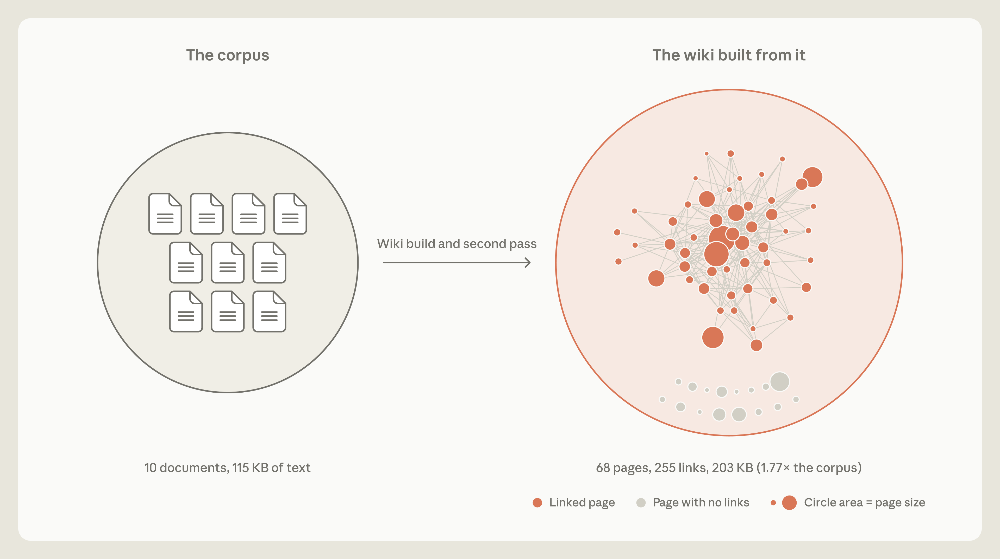

더 나쁜 경우도 있었습니다. 또 다른 LAB task에서는 wiki가 **원본보다 커졌습니다.**

- 왼쪽 원: corpus — 문서 10개, 115 KB
- 오른쪽 원: wiki — 68 페이지, 255 링크, **203 KB (원본의 1.77배)**. 원의 크기 차이가 곧 용량 차이입니다.
- 아래쪽 회색 점들은 **링크가 하나도 없는 고립 페이지**입니다. 지도 역할조차 하지 못하는 페이지입니다.

원문은 이를 보르헤스의 단편에 빗댑니다. 제국만큼 큰 지도를 그린 지도 제작자들처럼, 아무것도 추상화하지 못한 wiki를 만들어 버렸습니다.

→ **요약이 원본보다 길다면 그건 요약이 아닙니다.** Representation은 원본을 압축하고 연결할 때만 의미가 있습니다.

# 5. Dreaming ③: 승격, 목표 지향, 빈틈 메우기

---

## 5.1 노트를 계층 맨 위로 승격시킨다

Dreaming은 노트를 계층 맨 위(**injected context**)로 올릴 수 있습니다. 그러면 harness가 매 세션 시작 시 context에 미리 넣어주므로 Claude는 검색할 필요도 없고 **검색할 것이 있다는 사실조차 몰라도 됩니다.**

하지만 승격은 조심해야 합니다.
- 주입된 메모리는 매 세션 **token을 차지**합니다.
- 틀린 노트가 올라가면 **모든 세션에 오류가 전파**됩니다.
- 로드된다고 따르는 것도 아닙니다. Claude Code 문서도 instruction 파일이 길어질수록 준수율이 떨어진다고 경고합니다.

그래서 맨 위 층은 작게 유지해야 하고 dreaming의 일은 상당 부분 **세부사항을 아래 층으로 내리고 링크만 남겨두는 것**입니다.

- 실제 사례: Claude Code의 auto memory는 `MEMORY.md`의 **첫 200줄 또는 25 KB**만 로드합니다. 이 부분은 내용 자체가 아니라 "무엇을 알고 있고 어디에 있는지"를 보여주는 **index**입니다.

→ **맨 위 층에는 책의 본문 대신 목차를 두어야 합니다.**

## 5.2 메모리를 특정 목표에 맞춰 키운다

Wiki를 만드는 지시문은 과제마다 달라야 합니다. 계약서 묶음으로 기업 인수를 시뮬레이션하는 LAB task에서 이를 확인했습니다. 이 과제는 brief가 **계약 조항을 정확히 기술했는지**로 채점됩니다.

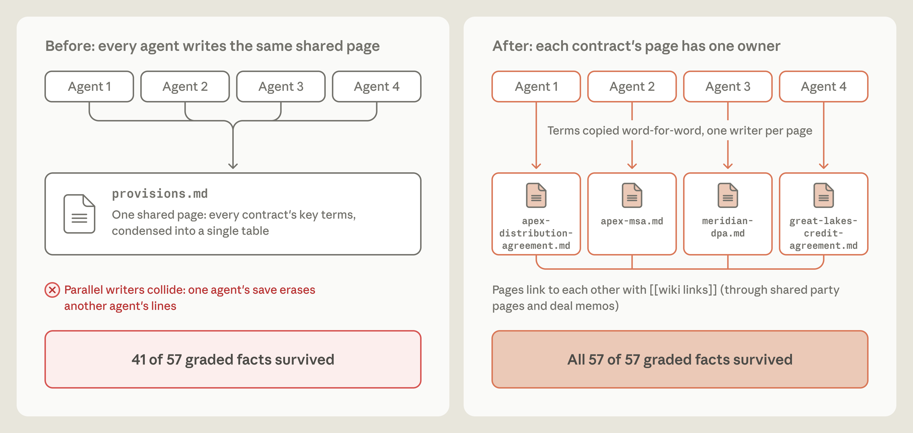

**왼쪽 (Before): 모든 에이전트가 같은 공유 페이지에 쓴다**
- 에이전트 4개가 `provisions.md` 하나에 모든 계약의 핵심 조항을 표로 요약해 넣습니다.
- 병렬 writer가 충돌합니다. **한 에이전트의 저장이 다른 에이전트의 줄을 지워버립니다.** 요약 과정에서 빠진 조항도 있었습니다.
- 결과: 채점 대상 57개 fact 중 **41개만 생존 (72%)**.

**오른쪽 (After): 계약서마다 주인이 한 명**
- 에이전트 하나가 계약서 하나를 맡아 전용 페이지(`apex-msa.md`, `meridian-dpa.md` 등)를 씁니다.
- 조항은 요약하지 않고 **원문 그대로 인용**합니다. 페이지끼리는 당사자 페이지와 deal memo를 통해 `[[wiki link]]`로 연결됩니다.
- 결과: **57개 중 57개 생존 (100%)**.

이 개선안을 **사람이 설계하지 않았다**는 게 중요합니다. Claude가 실패를 돌아보고 → 지시문 수정을 제안하고 → wiki를 다시 만드는 루프를 돌렸고 그 과정에서 "이 과제는 계약 조항이 핵심"이라는 사실을 스스로 발견해 지시문을 고쳐 썼습니다.

> 💡 두 가지 교훈이 겹쳐 있습니다. (1) **병렬 에이전트에게 공유 파일을 쓰게 하지 말 것** — 파일당 writer 한 명. (2) **정확성이 채점되는 정보는 요약하지 말고 인용할 것.**

## 5.3 한 세션이 남긴 빈틈을 메운다

세션 중의 Claude는 그 세션의 context만 봅니다. Dreaming은 **여러 세션을 가로질러** 공통 패턴을 찾거나 공통 실수를 바로잡을 수 있습니다.

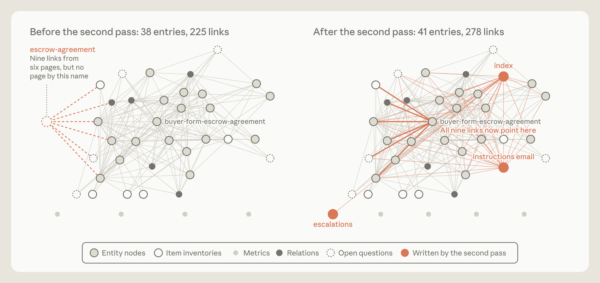

LAB task의 wiki에 dreaming을 한 번 더 돌린 전후입니다. 노드는 wiki 항목, 선은 링크입니다.

- **왼쪽 (second pass 전): 38개 항목, 225개 링크**
  - 왼쪽 가장자리의 주황 점선 원이 `escrow-agreement`입니다. 6개 페이지에서 9개 링크가 이 이름을 가리키는데 **그런 페이지는 존재하지 않습니다.** 서로 다른 세션이 아직 없는 페이지를 "있겠거니" 하고 링크한 결과입니다.
  - 정작 같은 문서를 다루는 `buyer-form-escrow-agreement` 페이지는 그래프 한가운데에 따로 있습니다.
- **오른쪽 (second pass 후): 41개 항목, 278개 링크**
  - 깨진 링크 9개가 모두 `buyer-form-escrow-agreement`로 다시 연결됐습니다(굵은 주황 선).
  - 새 페이지 3개가 추가됐습니다: `index`, `instructions email`, `escalations` (주황색 채워진 노드). 특히 `index`는 많은 페이지와 연결되어 wiki의 진입점이 됩니다.

→ **깨진 링크는 개별 세션 안에서는 보이지 않습니다.** 전체를 한 번에 훑어보는 pass가 있어야 발견됩니다.

# 6. 남은 질문들

---

원문은 결론 대신 아직 풀리지 않은 설계 질문을 정리합니다.

| 질문 | Trade-off |
|---|---|
| **언제 메모리를 쓸 것인가** | 세션 중 기록: salience를 현장에서 포착하고 즉시 쓸 수 있지만 **본 작업에서 주의를 빼앗음**. Dreaming: 백그라운드로 미룰 수 있지만 **결과를 바로 쓸 수 없음** |
| **어떻게 최신 상태로 유지할 것인가** | Dreaming이 오류를 고칠 수 있지만 compute가 듭니다. 모든 메모리를 계속 검증하는 건 비현실적 → **바뀔 가능성이 높은 정보에 집중**하거나, 접근 빈도에 따라 **dreaming 주기를 조정** |
| **Transcript search를 기본으로 삼을 것인가** | Representation + search 조합이 효과적일 때가 있지만 representation에 오류나 hallucination이 쌓이지 않도록 유지하는 데도 compute가 필요 |

마지막 문단이 글 전체를 요약합니다. Claude의 salience 판단은 좋아졌지만 **어떤 모델도 다음 턴에 무슨 일이 일어날지는 알 수 없습니다.** Dreaming은 뒤돌아볼 기회를 주고, 그 시간에 compute를 써서 메모리를 정리하고 고치고 다음 세션이 더 쉽게 꺼내 쓸 수 있는 형태로 만들어 둡니다.

### 실무에 가져갈 것

- **메모리 프롬프트는 짧게.** 용도만 알려주고 기록 규칙은 정하지 않습니다. 구형·소형 모델을 쓸 때만 "답하기 전에 메모리를 읽어라", "가설을 검증하라" 같은 명시적 지시를 추가합니다.
- **화면이나 환경에서 다시 읽을 수 있는 상태는 저장하지 않습니다.** 알아내는 데 비용이 든 규칙·계획·함정만 남깁니다.
- **Transcript는 버리지 않습니다.** Dreaming이 노트를 검증할 유일한 ground truth입니다.
- **Wiki는 여러 문서를 종합해야 하는 과제에만 투자합니다.** 단일 문서 lookup 위주라면 search로 충분합니다. Wiki 크기가 원본에 가까워지면 경고 신호입니다.
- **병렬 에이전트는 파일당 writer 한 명.** 정확성이 중요한 값은 요약 대신 원문 인용.
- **항상 로드되는 층은 index로 유지합니다.** 본문은 아래 층에 두고 링크만 올립니다.
