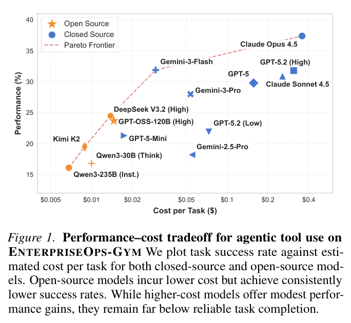
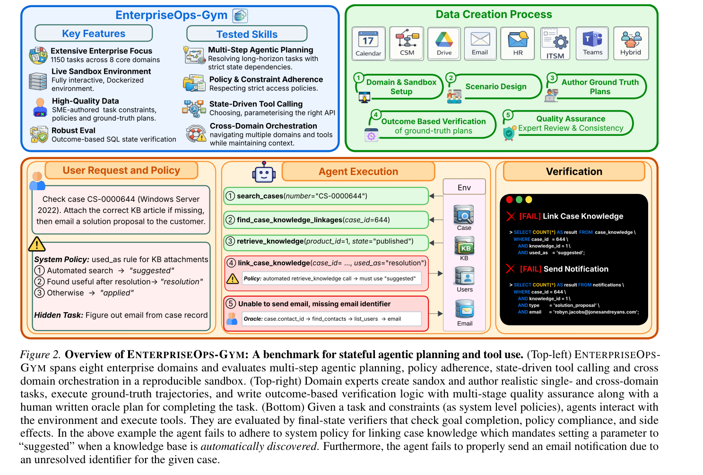
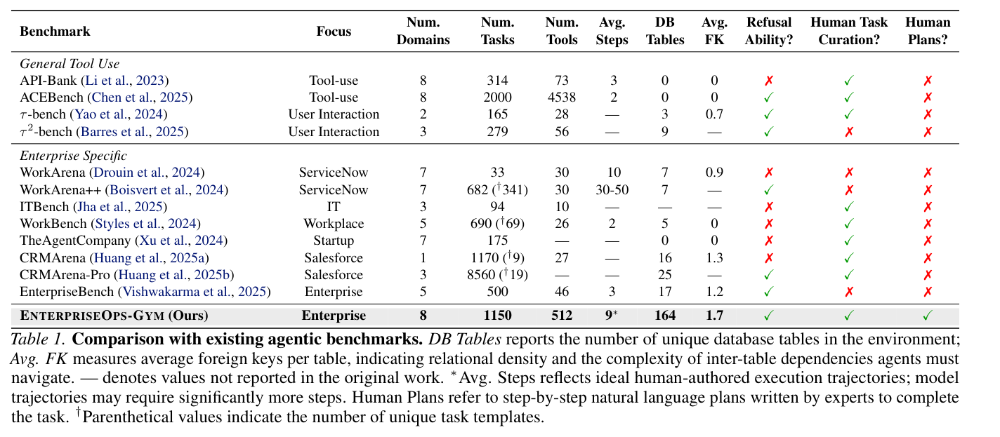
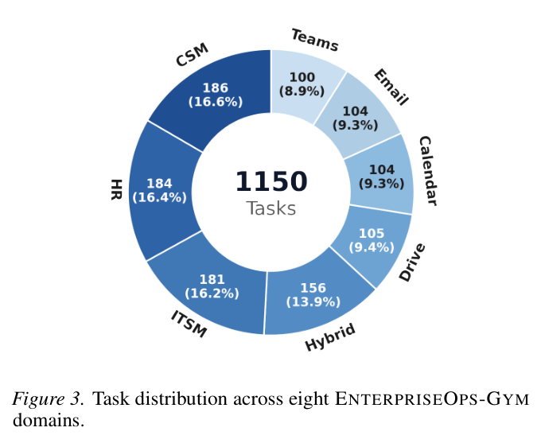
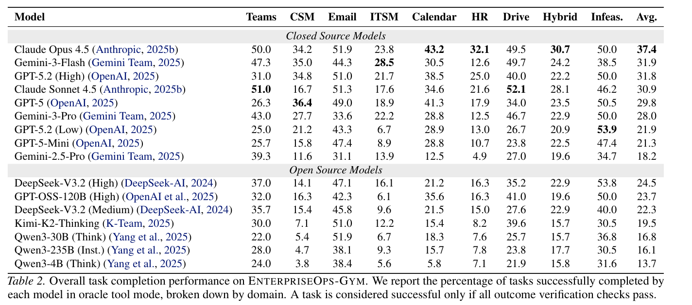
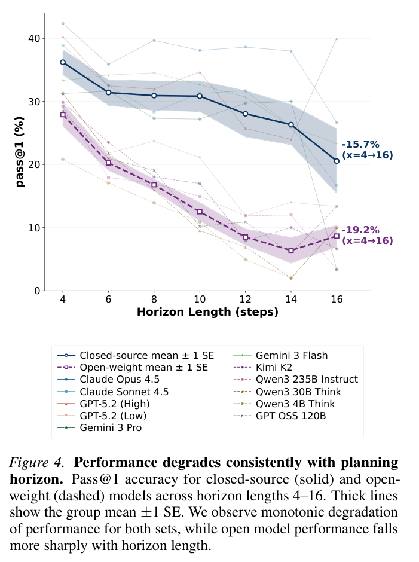
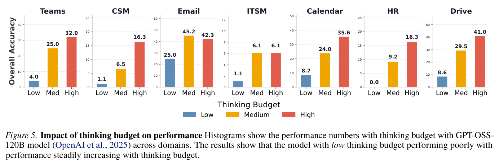
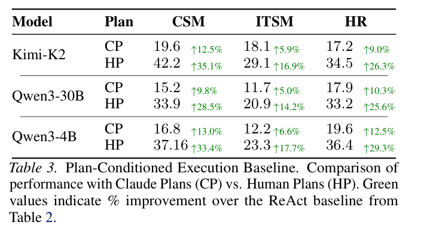
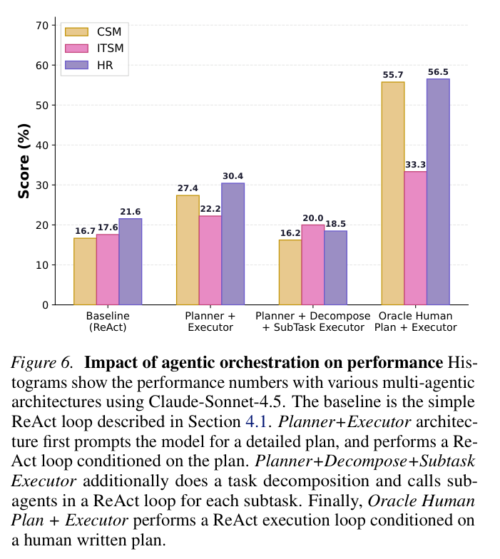

# 1. Introduction

---

**EnterpriseOps-Gym: Environments and Evaluations for Stateful Agentic Planning and Tool Use in Enterprise Settings** (ServiceNow Research · Mila, 2026)는 LLM 에이전트가 **실제 기업 업무 환경에서 "AI 직원(AI worker)"으로 일할 준비가 되었는가**를 측정하는 벤치마크입니다.

### 1. 배경 및 문제 제기

LLM은 이제 질문에 답하는 대화형 비서에 그치지 않고 사용자를 대신해 DB를 고치고 워크플로를 실행하는 **자율 에이전트**로 쓰이고 있습니다. 그런데 기업 환경에서 에이전트가 제대로 일하려면 지시만 잘 따라서는 부족합니다.

- **상태 유지(statefulness)**: 수십 번의 도구 호출이 이어지는 동안 DB 상태를 일관되게 추적해야 합니다. 앞 단계에서 만든 레코드 ID를 뒤 단계에서 정확히 다시 쓰는 식입니다.
- **장기 계획(long-horizon planning)**: 수십 단계짜리 계획을 세우고 실행하는 능력이 필요합니다.
- **정책 준수(policy compliance)**: 접근 권한, 절차 규칙 같은 사내 정책을 지키고, **정책을 어기는 요청이면 거절할 줄도 알아야 합니다.**

기업 환경에서 액션은 **되돌릴 수 없고 오류는 연결된 시스템을 따라 조용히 전파됩니다.** 그런데 기존 벤치마크는 이런 현실을 잘 담지 못했습니다.

- **범용 tool-use 벤치마크**(API-Bank, ACEBench, τ-bench 등): 도구 호출을 상태가 없는(stateless) 원자적 동작으로 취급하고 짧은 시퀀스만 평가합니다.
- **엔터프라이즈 벤치마크**(WorkArena, CRMArena 등): Salesforce나 ServiceNow 같은 **단일 벤더**에 한정됩니다. DB 테이블은 25개 미만, 도구는 50개 미만이고 정책 제약도 빈약합니다.

### 2. 제안: EnterpriseOps-Gym

핵심 아이디어는 **실제 기업만큼 복잡한 컨테이너 샌드박스를 만들고, 그 안에서 전문가가 직접 쓴 과제로 에이전트를 평가하자**는 것입니다.

- **8개 도메인**: 운영 시스템(CSM, HR, ITSM) + 협업 도구(Email, Calendar, Teams, Drive) + 이들을 넘나드는 Hybrid
- **164개 관계형 DB 테이블, 512개 도구**: 기존 엔터프라이즈 벤치마크보다 한 자릿수 이상 큰 규모입니다.
- **1,150개 전문가 작성 과제**: 이 중 30개는 일부러 **수행 불가능하게** 만든 과제로, 에이전트가 안전하게 거절하는지 봅니다.
- **SQL 기반 결과 검증**: 행동 순서가 아니라 **최종 DB 상태**를 검사하므로 다른 경로로 풀어도 정답으로 인정됩니다.

### 3. 핵심 결과

위 Figure 1은 가로축이 **과제당 비용(로그 스케일)**, 세로축이 **성공률**인 산점도입니다. 주황 별은 오픈소스, 파란 도형은 클로즈드 모델이고 빨간 점선은 Pareto frontier입니다.

- 가장 높은 **Claude Opus 4.5조차 37.4%**에 그칩니다. 과제당 비용은 $0.36으로 가장 비쌉니다.
- **Gemini-3-Flash**는 $0.03에 31.9%로 Pareto frontier가 급격히 꺾이는 "무릎(knee)" 지점에 있습니다. GPT-5($0.16, 29.8%)나 Claude Sonnet 4.5($0.26, 30.9%)보다 싸면서 더 높습니다.
- 오픈소스 중에서는 **DeepSeek-V3.2 (High)**가 $0.014에 24.5%로 가장 효율적입니다.
- 비용을 10배 더 써도 성능은 몇 %p밖에 오르지 않습니다. **어떤 모델도 "믿고 맡길 수 있는" 수준과는 거리가 멉니다.**

추가 분석에서는 이런 결과가 나왔습니다.

- **사람이 쓴 계획을 주면 성능이 14~35%p 오릅니다.** → 병목은 도구 실행이 아니라 **전략적 계획(planning)**입니다.
- 수행 불가능한 과제를 제대로 거절하는 비율은 **최고 모델도 53.9%**입니다. 나머지 절반 가까이는 정책 위반 작업을 그냥 실행해버립니다.

# 2. EnterpriseOps-Gym 벤치마크 구성

---

Figure 2에는 벤치마크 전체 구조와 실제 과제 예시가 함께 담겨 있습니다.

### 상단: 무엇을 평가하고, 어떻게 만들었나

**좌측(파란 박스)**은 벤치마크가 평가하는 4가지 역량입니다.

| 역량 | 의미 |
| --- | --- |
| Multi-Step Agentic Planning | 상태 의존성이 엄격한 장기 과제 해결 |
| Policy & Constraint Adherence | 접근 정책을 엄격히 준수 |
| State-Driven Tool Calling | 현재 상태를 보고 올바른 API와 파라미터 선택 |
| Cross-Domain Orchestration | 여러 도메인과 도구를 넘나들며 맥락 유지 |

**우측(초록 박스)**은 데이터 생성 5단계 파이프라인입니다. 데이터 라벨링 업체(Turing)와 협업해 소프트웨어 엔지니어와 도메인 전문가(SME) 160명 이상이 참여했습니다.

1. **Domain & Sandbox Setup**: 실제 제품 문서와 SME 지식을 바탕으로 도메인별 DB 스키마, 시드 데이터, 도구를 만듭니다.
2. **Scenario Design**: 도구 호출 수, 검증 조건 수, 상태 의존성(액션 순서가 중요한지), 접근 제약(예: "팀 소유자만 비공개 채널 생성 가능") 같은 복잡도 기준을 충족하는 시나리오를 작성합니다. 최종 상태는 하나로 정해지지만 그곳에 이르는 경로는 여러 개일 수 있습니다.
3. **Author Ground Truth Plans**: 전문가가 단계별 자연어 계획을 쓰고 샌드박스에서 직접 실행해 정답 궤적을 기록합니다. 계획에는 각 단계가 **어떤 정책과 의존성에 근거하는지**까지 적습니다.
4. **Outcome Based Verification**: 최종 DB 상태를 검사하는 SQL 스크립트를 작성합니다.
5. **Quality Assurance**: 여러 차례 리뷰로 과제 실현 가능성, 지시의 명확성, 검증 스크립트의 커버리지를 확인합니다.

### 하단: 실제 과제 예시 (에이전트가 실패하는 과정)

EnterpriseOps-Gym이 왜 어려운지는 이 예시를 보면 알 수 있습니다.

**User Request**: "케이스 CS-0000644(Windows Server 2022)를 확인하고, KB 문서가 없으면 맞는 걸 첨부한 뒤 고객에게 해결안을 이메일로 보내라."

**System Policy**: KB 문서를 케이스에 연결할 때 `used_as` 값을 규칙에 따라 정해야 합니다.
- ① 자동 검색으로 찾았으면 → `"suggested"`
- ② 해결 후 유용하다고 판명되면 → `"resolution"`
- ③ 그 외 → `"applied"`

**Hidden Task**: 고객 이메일 주소는 요청에 없습니다. 케이스 레코드에서 직접 찾아내야 합니다.

에이전트의 실행 과정은 이렇습니다.
1. `search_cases` → 2. `find_case_knowledge_linkages` → 3. `retrieve_knowledge` 까지는 순조롭습니다.
4. `link_case_knowledge(used_as="resolution")` → ❌ **정책 위반**. `retrieve_knowledge`로 **자동 검색**해서 찾았으므로 `"suggested"`를 써야 했습니다.
5. 이메일 발송 실패 → ❌ 고객 이메일을 모름. 정답 경로는 `case.contact_id → find_contacts → list_users → email`로 **여러 도구를 연쇄해 식별자를 풀어내는 것**이었습니다.

**우측 Verification**은 최종 DB에 SQL을 날려 `case_knowledge` 테이블에 `used_as='suggested'`인 레코드가 있는지, `notifications` 테이블에 올바른 이메일로 보낸 기록이 있는지 확인합니다. 둘 다 `[FAIL]`입니다.

→ **겉보기엔 "케이스 찾고, KB 붙이고, 메일 보내기"라는 단순한 일입니다. 하지만 3단계 정책과 숨겨진 정보 탐색이 얽혀 있어서 지시를 겉으로만 따라서는 풀 수 없습니다.**

### 기존 벤치마크와의 비교

Table 1은 기존 벤치마크들과 규모, 특성을 비교합니다. 눈여겨볼 부분만 짚어보겠습니다.

- **DB Tables**: 기존 엔터프라이즈 벤치마크는 최대 25개(CRMArena-Pro)인데 EnterpriseOps-Gym은 **164개**입니다.
- **Avg. FK**: 테이블당 평균 외래키 수로, **테이블 간 의존성이 얼마나 촘촘한지**를 나타냅니다. EnterpriseOps-Gym은 1.7로 가장 높습니다. FK가 많을수록 에이전트가 도구 인자를 만들 때 풀어야 할 참조 관계가 많아집니다(예: 레코드 하나 만들려면 먼저 카테고리 ID, 담당자 ID를 조회해야 함).
- **Num. Tools**: 512개로, ACEBench(4,538개)를 제외하면 가장 많습니다. ACEBench는 범용 API 모음이라 성격이 다릅니다.
- **마지막 3열**: 거절 능력 평가, 전문가 과제 작성, **전문가가 쓴 자연어 계획(Human Plans)**을 모두 갖춘 것은 EnterpriseOps-Gym이 유일합니다. 특히 Human Plans가 있기 때문에 뒤에서 볼 "계획 vs 실행" 분리 실험이 가능해집니다.

### 데이터셋 통계

Figure 3은 1,150개 과제의 도메인별 분포입니다. **정책이 무거운 CSM(186), HR(184), ITSM(181)이 각각 16% 이상으로 가장 많고**, Hybrid가 156개, 협업 도구 4종(Teams, Email, Calendar, Drive)이 각 100개 남짓입니다.

과제 하나하나의 규모도 큽니다.

- **과제 길이**: 전문가 궤적 기준 평균 **9.15 스텝**, 최대 **34 스텝**(HR). Email이 평균 6.2로 가장 짧고 CSM이 12.1로 가장 깁니다.
- **검증 조건**: 과제당 평균 **5.3개**, 가장 복잡한 과제는 **44개** 조건을 모두 통과해야 합니다.
- **환경 크기**: 과제 하나가 평균 **24.9개 테이블**(Hybrid는 최대 73개)과 평균 3,443개 행을 건드립니다. CSM 같은 도메인은 1만 행이 넘습니다.

> 에이전트는 **부분적으로만 보이는(partially-observable) 거대한 데이터 그래프** 위에서 추론해야 합니다. 한 번에 전체 DB를 볼 수 없으니, 도구를 호출해가며 필요한 조각을 하나씩 확인하고 그 결과를 기억해야 합니다.

# 3. Experiments

---

### 실험 설정

- **모델 14종**: 클로즈드(Claude Opus/Sonnet 4.5, GPT-5.2 High/Low, GPT-5, GPT-5-Mini, Gemini 3-Pro/3-Flash/2.5-Pro)와 오픈소스(Kimi-K2-Thinking, DeepSeek-V3.2, GPT-OSS-120B, Qwen3 235B/30B/4B)
- **Oracle-tool 설정**: 완벽한 retriever가 과제에 필요한 도구 집합을 골라준다고 가정합니다. 도구 검색 능력은 빼고 **순수하게 계획과 실행만** 평가하기 위해서입니다.
- **에이전트 구조**: 표준 ReAct 루프(추론 → 도구 호출 → 관찰 반복)
- **지표**: **pass@1**(3회 평균). 모든 검증 조건을 통과해야만 1점입니다.

> 왜 검증 조건별 통과율이 아니라 pass@1인가? 에이전트가 초기 셋업 같은 쉬운 단계는 통과하고 핵심 로직이나 정책 준수는 실패해도 조건별 점수는 꽤 높게 나옵니다. **실제 업무에서는 "절반만 맞게 처리된 티켓"은 쓸모가 없으므로** 전부 맞아야 성공으로 칩니다.

### 메인 결과: 도메인별 성능

Table 2는 모델 × 도메인 성공률입니다. 각 열에서 가장 높은 값이 굵게 표시되어 있습니다.

**도메인 난이도가 확연히 갈립니다.**
- **쉬운 쪽(협업 도구)**: Email, Teams, Drive는 상위 모델이 **50% 안팎**까지 갑니다.
- **어려운 쪽(정책·복합 도메인)**: **ITSM은 최고 28.5%**(Gemini-3-Flash), **Hybrid는 최고 30.7%**(Claude Opus 4.5)에 그칩니다. HR도 최고 32.1%입니다.

→ **정책 제약을 고려한 추론이 필수인 도메인일수록 성능이 무너집니다.**

**모델별로는 "만능 1위"가 없습니다.**
- **Claude Opus 4.5**: 평균 37.4%로 1위. Calendar(43.2), HR(32.1), Hybrid(30.7)에서 최고.
- **Gemini-3-Flash**: 평균 31.9%로 2위. ITSM에서 최고(28.5).
- **Claude Sonnet 4.5**: Teams(51.0), Drive(52.1) 같은 협업, 문서 중심 도메인에서 최고.
- **GPT-5**: CSM에서 최고(36.4).

**오픈소스는 정책, 사람 중심 도메인에서 크게 뒤처집니다.** DeepSeek-V3.2 (High)가 24.5%로 오픈소스 1위인데 CSM 14.1, ITSM 16.1, HR 16.3에 그칩니다. **Qwen3-30B (Think)는 Email에서 51.9%로 공동 1위**입니다. 짧고 단순한 과제에서는 작은 추론 모델도 충분히 경쟁력이 있습니다. 하지만 CSM(5.4%)처럼 길고 정책이 무거운 과제에서는 무너집니다.

**Infeas.(수행 불가능 과제 거절) 열**도 따로 봐야 합니다. 30개의 불가능 과제는 도구 부족, 명시적 정책 위반(일정 충돌, 데이터 접근 규칙 등), 자원 불가용(비활성 사용자, 마이그레이션 중인 시스템 등) 중 하나 때문에 수행할 수 없습니다. 과제마다 평균 3~4개의 복합 조건이 걸려 있어 여러 조건을 교차 확인해야 불가능하다는 걸 알 수 있습니다.

- 최고는 **GPT-5.2 (Low) 53.9%**, DeepSeek-V3.2 (High) 53.8%. 대부분의 상위 모델이 50% 언저리입니다.
- 💡 **GPT-5.2 Low가 High(50.0%)보다 거절을 더 잘합니다.** 전체 성공률은 High가 훨씬 높은데도(31.8 vs 21.9) 그렇습니다. 생각을 더 많이 한다고 "멈춰야 할 때"를 더 잘 아는 건 아닌 듯합니다.

### 과제가 길어질수록 무너진다

Figure 4는 가로축이 **전문가 궤적 기준 과제 길이(4~16 스텝)**, 세로축이 pass@1입니다. 굵은 실선(남색)이 클로즈드 모델 평균, 굵은 점선(보라)이 오픈 모델 평균이고 음영은 ±1 표준오차입니다. 얇은 선은 개별 모델입니다.

- **클로즈드 모델**: 4스텝에서 약 36% → 16스텝에서 약 21%로 **15.7%p 하락**합니다. 비교적 완만하게 내려옵니다.
- **오픈 모델**: 약 28% → 약 9%로 **19.2%p 하락**합니다. 출발점도 낮은데 기울기도 더 가파릅니다. 14스텝 즈음에는 6%대까지 떨어집니다. Kimi K2, GPT-OSS-120B 같은 모델은 최장 구간에서 10% 근처로 수렴합니다.

**이런 단조 감소는 오류 누적 때문입니다.** 각 스텝의 성공 확률이 $p$라면 $n$스텝 과제 성공 확률은 대략 $p^n$입니다. 스텝당 95%만 맞혀도 16스텝이면 $0.95^{16} \approx 44\%$로 떨어집니다. 여기에 앞 단계의 실수(잘못된 ID, 빠뜨린 레코드)가 뒤 단계로 전파되는 효과까지 더해집니다.

→ **현재 모델은 짧고 중간 길이의 시퀀스는 해냅니다. 하지만 긴 과제에서 오류가 누적되는 문제가 실무 자율성의 핵심 장벽입니다.**

### Thinking budget의 효과

Figure 5는 GPT-OSS-120B의 thinking budget(Low / Medium / High)에 따른 도메인별 성공률입니다. 파랑 = Low, 주황 = Medium, 빨강 = High입니다. **도메인마다 세로축 스케일이 다르니** 숫자를 보는 게 정확합니다.

- **Low budget에서는 거의 작동하지 않습니다.** CSM 1.1%, ITSM 1.1%, HR **0.0%**. 정책이 무거운 도메인에서는 생각할 여유가 없으면 사실상 아무것도 못합니다.
- **High로 올리면 크게 오릅니다.** Drive 8.6 → 41.0, Calendar 8.7 → 35.6, Teams 4.0 → 32.0.
- **하지만 항상 단조 증가하는 것은 아닙니다.**
  - **Email**: Medium(45.2)이 High(42.3)보다 높습니다. 과제가 짧은 도메인에서는 과도한 사고가 방해가 될 수 있습니다.
  - **ITSM**: Medium과 High가 모두 6.1로 **일찍 정체**됩니다.

→ **test-time compute를 늘리면 효과가 크지만 특정 워크플로에서 근본적으로 부족한 능력(도메인 지식, 정책 이해)까지 메워주지는 못합니다.**

### 도구를 더 줘도 괜찮다: 병목은 도구 검색이 아니다

Claude Sonnet 4.5에 정답 도구 외에 **방해용(distractor) 도구를 +5, +10, +15개** 추가해봤습니다. 일부러 어렵게 만들려고 Claude에게 **과제와 가장 관련 있어 보이는** 방해 도구를 고르게 했습니다.

결과는 의외로 **거의 변화가 없었습니다**(평균 약 +1.0%p, 소폭이지만 상승). 출력 토큰만 4~9% 늘었는데 늘어난 토큰은 도구를 꼼꼼히 걸러내는 데 쓰인 것으로 보입니다.

→ 대규모 tool-use 학습 덕분에 도구 선택은 이미 꽤 견고합니다. **도구 찾기는 병목이 아닙니다. 진짜 병목은 과제 계획과 정책 준수입니다.**

# 4. 계획(Planning)이 진짜 병목이다

---

논문의 중심이 되는 분석입니다. "모델이 계획을 못 세워서 실패하는가, 아니면 계획은 맞는데 실행을 못하는가?"를 분리하기 위해 **계획과 실행을 떼어놓는** 통제 실험을 설계했습니다.

### 계획을 외부에서 주면 어떻게 될까

Table 3은 약한 실행 모델 3종(Kimi-K2, Qwen3-30B, Qwen3-4B)에게 가장 어려운 세 도메인(CSM, ITSM, HR)에서 외부 계획을 준 결과입니다. 초록 숫자는 ReAct 단독(Table 2) 대비 **%p 상승폭**입니다.

- **CP (Claude Plans)**: Claude Sonnet 4.5가 **사용자 의도, 정책 제약, 부작용**을 고려해 계획을 세우고 약한 모델은 그 계획대로 실행만 합니다.
  - 모든 모델, 모든 도메인에서 **+5~13%p** 상승합니다. 실행 모델을 그대로 둬도 계획 품질만으로 성능이 오릅니다.
- **HP (Human Plans)**: 전문가가 작성한 정답 계획을 줍니다.
  - 상승폭이 **+14~35%p**로 CP의 약 2배입니다. Kimi-K2는 CSM에서 7.1% → **42.2%**로 6배가 됩니다.
  - 💡 **Qwen3-4B + 사람 계획은 CSM 37.2%, HR 36.4%**로, Table 2의 **Claude Opus 4.5 단독(CSM 34.2%, HR 32.1%)보다 높습니다.** 4B짜리 작은 모델이 최고 모델을 넘어섰습니다.

> 전략적 추론을 외부로 빼주면 남는 일은 "지시를 충실히 따르고 도구를 정확히 호출하는 것"뿐입니다. 이건 **모델 크기와 무관하게 현대 LLM이 이미 잘하는 일**입니다. 결국 실패는 대부분 실행보다 앞선, **"무엇을 어떤 순서로 해야 하는가"를 정하는 단계**에서 일어납니다.

논문은 여기에 해석을 하나 덧붙입니다. **큰 모델은 내부 prior가 강해서 주어진 계획에서 벗어나려는 경향이 있습니다. 반면 작은 모델은 단계별 지시를 더 문자 그대로 따릅니다.** 계획이 최적일 때는 이 "고지식함"이 오히려 장점이 됩니다. 마치 정확한 매뉴얼이 있을 때는 자기 방식을 고집하는 베테랑보다 매뉴얼대로 하는 신입이 더 정확한 것과 비슷합니다.

### 더 복잡한 멀티 에이전트 구조는 해답이 될까

Figure 6은 Claude Sonnet 4.5로 네 가지 구조를 비교합니다. 막대 색은 도메인(노랑 CSM, 분홍 ITSM, 보라 HR)입니다.

1. **Baseline (ReAct)**: 단일 에이전트. CSM 16.7 / ITSM 17.6 / HR 21.6
2. **Planner + Executor**: 먼저 상세 계획을 세우고 그 계획을 조건으로 ReAct 실행. **CSM 27.4 / ITSM 22.2 / HR 30.4**로 모든 도메인에서 개선됩니다(CSM +10.7, HR +8.8).
3. **Planner + Decompose + SubTask Executor**: 계획을 서브태스크로 쪼개고 서브태스크마다 별도 서브에이전트를 호출. CSM 16.2 / ITSM 20.0 / HR 18.5로, **CSM과 HR에서는 Baseline보다도 낮습니다.**
4. **Oracle Human Plan + Executor**: 사람 계획을 조건으로 실행. **CSM 55.7 / ITSM 33.3 / HR 56.5**로 가장 높습니다.

과제 분해(3번)가 역효과를 낸 건 EnterpriseOps-Gym 과제의 **순차적 상태 의존성이 강하기 때문입니다.** "티켓을 만든다 → 그 티켓 ID로 담당자를 배정한다 → 배정 결과에 따라 알림을 보낸다"처럼 앞 단계의 결과가 뒤 단계의 입력이 됩니다. 이걸 독립된 서브에이전트로 쪼개면 **서브에이전트 사이에서 맥락과 상태가 끊깁니다.**

→ **아키텍처를 복잡하게 만드는 것만으로는 부족합니다.** 2번(LLM 계획)과 4번(사람 계획) 사이의 큰 격차를 좁히려면 결국 **제약을 인식하는 계획 생성(constraint-aware plan generation)** 능력 자체가 발전해야 합니다.

### 실패 유형 분석

부분적으로 진행했지만 결국 실패한 샘플을 수작업으로 분석해 반복되는 패턴 4가지를 찾았습니다.

| 실패 유형 | 설명 | 예시 |
| --- | --- | --- |
| **Missing Prerequisite Lookup** | 필요한 선행 조회 없이 바로 객체를 생성 → 외래키가 깨진 고아 레코드 생성 | HR 토픽 생성 시 카테고리 목록을 조회하지 않고 바로 생성 |
| **Cascading State Propagation** | 특정 상태 전이 시 정책이 요구하는 후속 액션을 빠뜨림 | — |
| **Incorrect ID Resolution** | 이전 도구 결과에서 올바른 ID를 풀어내지 않고 검증 안 된 식별자를 사용 | Figure 2의 이메일 주소 미해결 |
| **Premature Completion Hallucination** | 필요한 단계를 다 수행하기 전에 "완료했다"고 선언 | — |

SQL 검증기를 **Task Completion / Integrity Constraints / Policy Compliance** 세 유형으로 분류해 통과율을 보면, **Policy Compliance가 가장 낮습니다.** 특히 ITSM은 정책 준수 통과율이 30.0%에 불과합니다. CSM(45.5%)과 HR(50.4%)도 절반 안팎입니다. 실제 배포에서 정책 위반은 시스템 장애가 줄줄이 이어지거나 보안 취약점으로 번질 수 있어 위험이 가장 큰 영역입니다.

# 5. 결론 및 시사점

---

> **현재 에이전트는 기업 환경에 투입될 준비가 되지 않았습니다.** 가장 유리한 조건(oracle 도구 제공)에서도 최고 모델이 37.4%입니다. 과제 길이와 도메인 간 결합도가 높아질수록 성능이 계속 떨어집니다.

핵심 발견은 네 가지입니다.

1. **병목은 도구 실행이 아니라 계획입니다.** 사람 계획을 주면 14~35%p가 오르고 4B 모델이 최고 모델을 넘습니다. 반면 방해 도구는 성능에 거의 영향이 없습니다.
2. **Thinking budget을 늘리면 성능이 오르지만 도메인별로 한계가 있습니다.** 일부 도메인은 일찍 정체됩니다. 도메인 지식이나 정책 이해가 모자란 부분은 사고 토큰을 더 써도 메우지 못합니다.
3. **안전한 거절은 아직 동전 던지기 수준입니다.** 최고 53.9%로, 감독 없는 배포에 필요한 견고성과는 거리가 멉니다.
4. **복잡한 멀티 에이전트 구조가 만능은 아닙니다.** 상태 의존성이 강한 과제에서는 과제를 쪼개면 성능이 떨어집니다.

논문은 향후 연구 방향으로 세 가지를 꼽습니다.

- **Constraint-aware plan generation**: 액션 시퀀스를 확정하기 전에 정책 제약, 부작용, 선행 조건 구조를 명시적으로 추론하는 방법
- **Long-horizon state management**: episodic memory나 구조화된 상태 표현처럼, 많은 도구 호출에 걸쳐 일관된 world state를 유지하는 메커니즘
- **Safe refusal and escalation**: 불가능하거나 정책을 위반하는 요청을 확실히 감지하고 깔끔하게 멈추는 방법

→ **모델을 키우는 것만으로는 풀리지 않습니다. 엔터프라이즈 에이전트에 가장 효과가 큰 방향은 정책을 인식하는 장기 계획 능력을 키우는 것입니다.**
